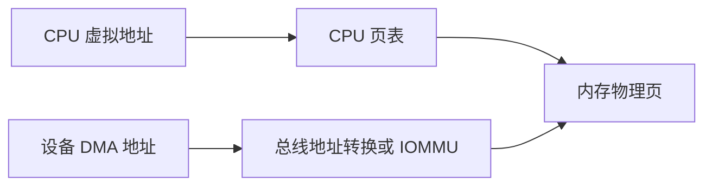
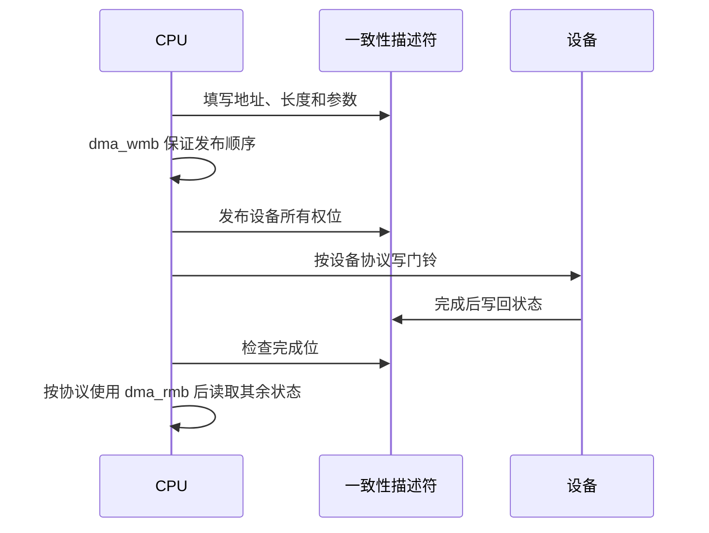
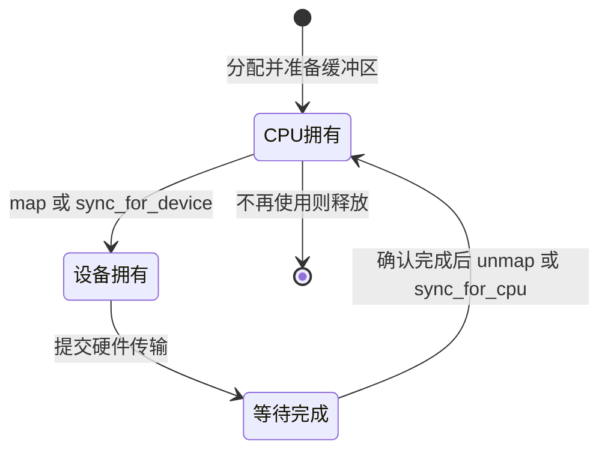

---
tags:
  - Linux
  - 内核
  - DMA
title: DMA 与 Cache 一致性入门
description: CPU 与设备地址、映射所有权、完成与回收、缓存同步及驱动排障
date: 2026/05/16
aliases:
  - "linux/内核机制/DMA 与 Cache 一致性入门"
  - "articles/linux/内核机制/DMA 与 Cache 一致性入门"
contentType: knowledge
showArticleMeta: true
modified: 2026-10-12
---

本文讨论直接内存访问（DMA，Direct Memory Access）驱动最容易出错的边界：CPU 填完缓冲区，并不代表设备已经能读到；设备启动传输，也不代表驱动已经可以释放缓冲区。

**范围**：以 Linux 6.12 的通用 DMA API 为参照。厂商 BSP 应对照其内核文档和设备手册；文中的硬件提交与完成处理是时序说明，不是可直接加载的驱动。

## 读完能解决什么

- 区分 CPU 虚拟地址、物理地址和设备 DMA 地址。
- 判断何时使用一致性映射（coherent mapping），何时使用流式映射（streaming mapping）。
- 按“准备 → 交给设备 → 确认完成 → 回收”检查驱动，而不是只检查 API 是否成对。

## 1. 设备拿到的地址是什么

CPU 使用 `void *`；设备使用 `dma_addr_t`。输入输出内存管理单元（IOMMU，Input–Output Memory Management Unit）可以让 DMA 地址与物理地址不同。因此不能把 `virt_to_phys()` 的结果直接当作通用 DMA 地址，也不能把 `dma_addr_t` 转成指针解引用。

映射 API 还可能处理缓存维护和地址可达性，例如借助反弹缓冲区（bounce buffer）。它不只是“把地址换个类型”。参见 [DMA 地址说明](https://docs.kernel.org/6.12/core-api/dma-api-howto.html#cpu-and-dma-addresses)。

## 2. 先确认设备能访问哪些地址

初始化时按硬件支持的位宽调用 `dma_set_mask_and_coherent(dev, DMA_BIT_MASK(bits))`，检查返回值。`bits` 来自设备寻址能力，不能为了分配成功随意填 64。

若描述符只能存 32 位地址、载荷地址支持 64 位，应分别设置 coherent mask 和 streaming mask。映射成功后仍要按寄存器或描述符格式写入地址，避免高位被截断。相关接口见 [DMA API](https://docs.kernel.org/6.12/core-api/dma-api.html#part-ic-dma-addressing-limitations)。

## 3. 两种映射如何分工

| 维度 | 一致性映射 | 流式映射 |
|---|---|---|
| 分配与建立 | `dma_alloc_coherent` | 分配缓冲区后 `dma_map_single` / `dma_map_sg` |
| 常见用途 | 描述符、状态区 | TX / RX 载荷 |
| CPU 与设备可见性 | 无需显式缓存刷新来保证一致性 | 按所有权切换调用 map、unmap 或 sync |
| 回收 | 设备停止使用后 `dma_free_coherent` | 设备停止使用后 unmap，再释放原始缓冲区 |

一致性不等于访问有序，也不等于设备已经完成。写入描述符内容，再发布所有权位，需要对应的 DMA 内存屏障；寄存器门铃（doorbell）的访问顺序另按 MMIO API 和设备协议处理。

`dma_wmb()` 不是“等待 DMA 完成”。图中的屏障用于共享 DMA 内存；是否需要 MMIO 读回等步骤取决于设备。参见 [内核内存屏障中的 DMA 示例](https://docs.kernel.org/6.12/core-api/wrappers/memory-barriers.html)。

## 4. 流式映射：所有权比函数名字更重要

方向以设备为参照：`DMA_TO_DEVICE` 是设备读内存，`DMA_FROM_DEVICE` 是设备写内存；双方都写的情况才考虑 `DMA_BIDIRECTIONAL`。

设备拥有期间，CPU 不应访问对应流式缓冲区。传输结束后有两种路径：

- **一次性映射**：确认设备完成 → `dma_unmap_single` → CPU 使用结果或释放缓冲区。
- **长期复用映射**：确认设备完成 → `dma_sync_single_for_cpu` → CPU 按方向允许的方式访问 → `dma_sync_single_for_device` → 再次交给设备；最终仍需 unmap。

例如 RX 缓冲区映射为 `DMA_FROM_DEVICE`，CPU 接管后可以读取数据，但不要在此映射协议下随意修改载荷。若协议要求 CPU 和设备都写，应重新评估方向。

### 一次 TX 的审查顺序

1. 用可用于该映射 API 的分配方式取得缓冲区，填入完整载荷。
2. `dma_map_single(dev, buf, len, DMA_TO_DEVICE)`，用 `dma_mapping_error()` 判断失败。
3. 保存 `buf`、DMA 地址、长度和方向，提交给硬件。
4. 通过中断或轮询确认**这次传输**完成，保证设备不会再访问缓冲区。
5. 用相同的设备、地址、长度、方向调用 `dma_unmap_single()`，然后释放原始缓冲区。

**超时是“还没有观察到完成”，不是“设备已停止”。** 超时清理必须先执行设备的停止或复位流程，并确认 DMA 已静止，再 unmap/free。否则设备可能写入已被分配给其他对象的内存。这是驱动生命周期的设计约束，需结合设备手册判断。

## 5. 缓冲区与 scatter-gather

`dma_map_single()` 不接受任意虚拟地址。常见可用来源包括适当的 `kmalloc()` 分配；栈、模块静态区、直接传入的 `vmalloc()` 地址都不能当作通用单段 DMA 缓冲区。还需避免 CPU 数据与设备数据共享同一缓存行（cache line），尤其在非一致性平台上。

分散聚集（SG，Scatter–Gather）映射有两个不同的计数：

- `nents`：传入 `dma_map_sg()` 的原始条目数。
- `mapped_nents`：返回的设备可见段数，可能因为合并而减少；返回 0 表示失败。

提交硬件时按返回段数遍历 `sg_dma_address()` 和 `sg_dma_len()`；unmap 和 `dma_sync_sg_*` 使用原始 `nents`。不要把这两个计数混用。参见 [流式 DMA 与 SG API](https://docs.kernel.org/6.12/core-api/dma-api.html#part-id-streaming-dma-mappings)。

## 6. 设备树声明与硬件事实

`dma-coherent` 描述设备 DMA 的硬件一致性属性，不能通过添加它让非一致性的设备“变成一致性”。`dma-ranges` 描述总线 DMA 地址窗口的转换，也不能替代正确的 DMA mask。

设备树地址窗口的定义见 [Devicetree 的 dma-ranges](https://devicetree-specification.readthedocs.io/en/stable/devicetree-basics.html#dma-ranges)。

板级检查至少包括：设备手册中的寻址位宽、总线路径、IOMMU 配置、BSP 的 DMA 实现。RISC-V、ARM 或 x86 的架构名称本身不能证明某个外设具备一致性。

## 7. 排障：从协议到映射

| 现象 | 优先核查 | 可收集的证据 |
|---|---|---|
| 只在大内存或特定板上失败 | 地址高位截断、mask、映射失败 | 硬件位宽、DMA 地址、返回值 |
| 数据偶发陈旧 | 所有权和方向、缓存同步 | 提交与完成序号、sync 时点 |
| 超时后其他内存被破坏 | 是否先释放再停设备 | 复位完成条件、缓冲区生命周期 |
| SG 某些载荷不完整 | 返回段数与原始段数混用 | 两个计数、每段地址和长度 |
| 描述符已就绪但参数不完整 | 发布顺序与屏障 | 描述符格式、所有权位协议 |

实践时记录 `uname -r`、设备型号、BSP 版本、DMA 位宽和 IOMMU 状态。先在受控环境检查一笔传输的 map/提交/完成/unmap 顺序，再增加并发。预期证据是每笔传输均有对应完成与回收记录；不要把本篇当作已在某块开发板实测通过的结果。

## 相关条目

- [[knowledge/linux/内核机制/MMU 与 IOMMU 案例串联]]
- [[knowledge/linux/内核机制/如何通过虚拟地址查找物理地址]]
- [[knowledge/linux/学习路径/中断与下半部机制]]
- [[knowledge/linux/驱动与模块/platform 驱动完整案例]]
