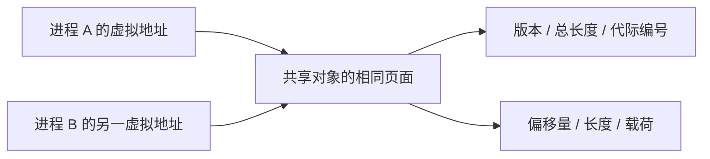
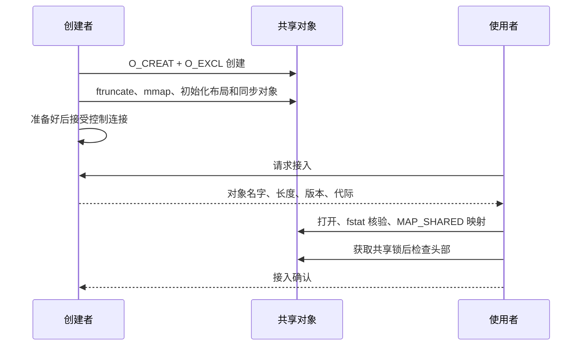
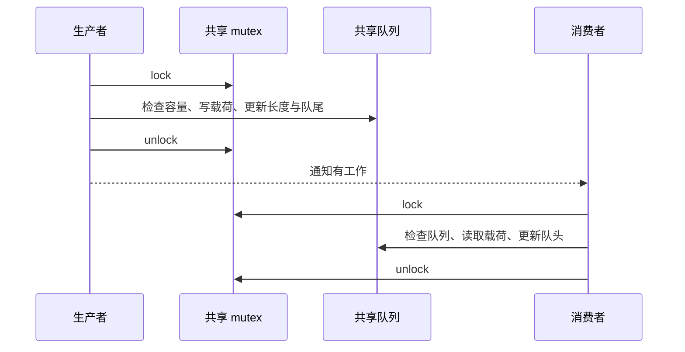
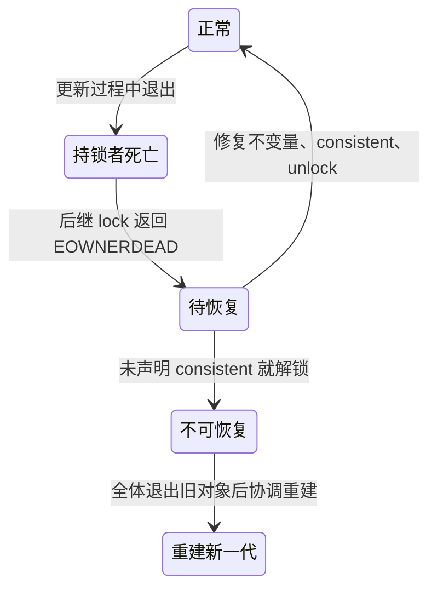

两份程序都能 `mmap()` 同一个对象，只说明它们共享了存储。要作为进程间通信（IPC，Inter-Process Communication）通道，还必须回答：谁初始化、何时可以访问、用什么同步、进程死亡后由谁恢复。

**范围**：Linux 用户态、POSIX 共享内存与 pthread 同步。本文给出可审查的协议和实验步骤；不把某个 CPU 上可行的原子操作，直接推广成跨编译器、跨架构的进程间无锁保证。

## 读完能带走什么

- 为独立启动的创建者和使用者设计就绪协议。
- 区分共享映射、互斥、通知三个职责。
- 理解名字删除、映射释放和共享对象实际销毁之间的区别。

## 1. 共享的是对象，不是指针值

两个进程的映射基址可以不同。跨进程存储对象关系时使用相对偏移量（offset），通过各自的映射基址换算；不要放私有堆指针、`std::string` 或带进程内资源的对象。

设计头部时明确固定宽度字段、字节序、对齐、版本和总长度；消费者先验证边界，再计算地址。平台不一致时还需定义序列化格式，不能直接用结构体二进制布局当通信协议。

共享对象通过 `shm_open()` 打开，`ftruncate()` 设定大小，`mmap(..., MAP_SHARED, ...)` 建立映射。`MAP_PRIVATE` 的写入不能用于把修改发布给其他进程。参见 [shm_open](https://man7.org/linux/man-pages/man3/shm_open.3.html) 与 [mmap](https://man7.org/linux/man-pages/man2/mmap.2.html)。

## 2. 创建与初始化必须有唯一负责人

一个适合先做正确性基线的方案：使用本机 Unix 域 Socket 作为控制通道，由创建者完成共享区初始化后才接受使用者。

这里控制通道约束接入时机，**共享数据的可见性仍由同步协议保证**。`O_EXCL` 创建成功者负责初始化；收到 `EEXIST` 的进程不能直接清零已有对象。未扩容的对象长度为 0，访问超出对象大小的映射可能出现 `SIGBUS`。

初始化失败时，创建者按已完成步骤关闭 fd、撤销映射，并删除自己这一代对象的名字。启动时发现旧名字，也不能只凭 PID 不存在就删除：要结合监督进程、代际编号、其他参与者是否退出等协议判断。

这一控制通道设计是工程方案，不是 POSIX 强制要求。也可采用独立的引导锁和明确的 READY 发布协议，但引导锁自身必须已经可靠初始化，不能用一个尚未初始化的共享 mutex 保护它自己的初始化。

## 3. mutex 必须真的能跨进程使用

普通 pthread mutex 默认是进程私有的。用于跨进程同步时需同时满足：

1. `pthread_mutex_t` 本体位于共享映射中。
2. 创建者在属性中设置 `pthread_mutexattr_setpshared(..., PTHREAD_PROCESS_SHARED)`，检查返回值，再初始化 mutex。
3. 初始化仅执行一次；所有使用者完成接入后，才能获取该锁访问共享数据。

pthread 接口直接返回错误码，通常不是通过 `errno` 报错；不支持共享属性的目标系统应拒绝启动或改用其他同步方式。参见 [进程共享 mutex 属性](https://man7.org/linux/man-pages/man3/pthread_mutexattr_getpshared.3.html)。

先用共享 mutex 建立基线，再根据测量决定是否改成单生产者单消费者（SPSC，Single Producer Single Consumer）队列。锁的临界区必须包括维持队列不变量所需的全部修改，而不是只锁某一个计数器。

`volatile` 不提供互斥，也不建立发布与获取语义。C/C++ 原子类型是否无锁、是否适合该进程共享布局，需要结合实现和 ABI 验证；不能把“线程内原子操作示例”直接移入共享区。

## 4. 通知不代替共享数据协议

通知告诉对方“应该检查队列”，队列本身回答“有多少条、内容是什么”。Linux 的 `eventfd` 是可与 `poll` / `epoll` 配合的计数通知对象；创建者的 fd 编号不能直接传给独立进程，应通过 Unix 域 Socket 的 fd 传递机制共享同一对象，或在 `fork()` 时继承。见 [eventfd](https://man7.org/linux/man-pages/man2/eventfd.2.html)。

先保持简单协议：生产者成功入队后通知，消费者被唤醒后重新检查队列。消费者不能认为“一次唤醒恰好对应一条消息”。队列满时也要明确阻塞、返回失败还是丢弃；不能悄悄覆盖尚未消费的数据。

从“每次入队都通知”优化为“只在空变非空时通知”，会引入消费者准备休眠与生产者发布数据之间的竞态，应单独设计并验证防丢唤醒协议。不要只加一个 `sleeping` 标志就宣布解决。

## 5. 进程死亡：锁恢复不等于数据恢复

健壮互斥锁（robust mutex）可以暴露持锁进程死亡。初始化时额外设置 `PTHREAD_MUTEX_ROBUST`，获取锁得到 `EOWNERDEAD` 时，调用者已经获得该锁，但共享数据可能处于半更新状态。

必须先按业务协议修复不变量，再调用 `pthread_mutex_consistent()`，最后解锁。无法修复时不能假装成功；未恢复就解锁会使后续获取遇到 `ENOTRECOVERABLE`。见 [robust mutex 状态语义](https://man7.org/linux/man-pages/man3/pthread_mutexattr_setrobust.3.html)。

可恢复队列的一种设计是为槽位保存状态、序号和提交标记，恢复时丢弃未提交项，并重新核验队头队尾。具体规则取决于队列布局；robust 属性不会自动回滚业务数据，也不能检测任意无锁写者的死亡。

## 6. close、munmap、unlink 是不同动作

| 操作 | 当前进程发生什么 | 其他进程发生什么 |
|---|---|---|
| `close(fd)` | 关闭描述符，已有映射仍可使用 | 不撤销它们的映射 |
| `munmap()` | 撤销本进程映射 | 不撤销它们的映射 |
| `shm_unlink()` | 删除对象名字 | 已有引用仍可使用；新的按名字打开失败 |

对象在名字被删除、相关引用都释放后才最终销毁。**同名重建是新的对象**：旧映射不会迁移到新对象，可能造成两组进程各自访问不同代际的数据。见 [POSIX 共享对象生命周期](https://man7.org/linux/man-pages/man7/shm_overview.7.html)。

清理时先停止接入，协调所有参与者停止使用，再处理同步对象和映射；不要在仍有人等待时销毁 mutex 或 semaphore。仅调用 `shm_unlink()` 不等于完成了整个退出协议。

## 7. 最小实践与验收证据

环境：Linux、目标 libc 支持进程共享 mutex。编译 pthread 程序通常需要 `-pthread`；较旧系统使用 `shm_open()` 还可能需要 `-lrt`。以下是实验设计，尚未提供在实际板卡上的测量结果。

| 实验 | 操作 | 应观察到的证据 |
|---|---|---|
| 正常接入 | 创建者完成初始化后，两独立进程接入 | 版本、长度和代际相同，地址不同也能读取同一数据 |
| 初始化延迟 | 创建后延迟扩容与就绪 | 使用者不能把 EEXIST 当成 READY |
| 并发修改 | 两进程在共享锁内递增计数 | 双方退出后计数等于成功递增次数 |
| 持锁进程死亡 | 受控终止临界区中的进程 | 后继观察 EOWNERDEAD，按规则恢复或拒绝继续 |
| 名字删除 | 已映射时 unlink，再尝试重新打开 | 旧映射仍有效，新打开得到 ENOENT |
| 同名重建 | 删除名字后创建新代际 | 旧映射与新映射的代际不同 |

可以用 `strace -f -e trace=openat,ftruncate,mmap,munmap,close,unlink,futex` 检查 Linux 上的调用轨迹；重点对照生命周期事件，而不是只统计“共享内存用了几次系统调用”。

## 相关条目

- [[knowledge/linux/内核机制/传统 IPC：System V 与 POSIX]]
- [[knowledge/编程语言/C++/无锁编程]]
- [[knowledge/编程语言/C++/Memory model]]
