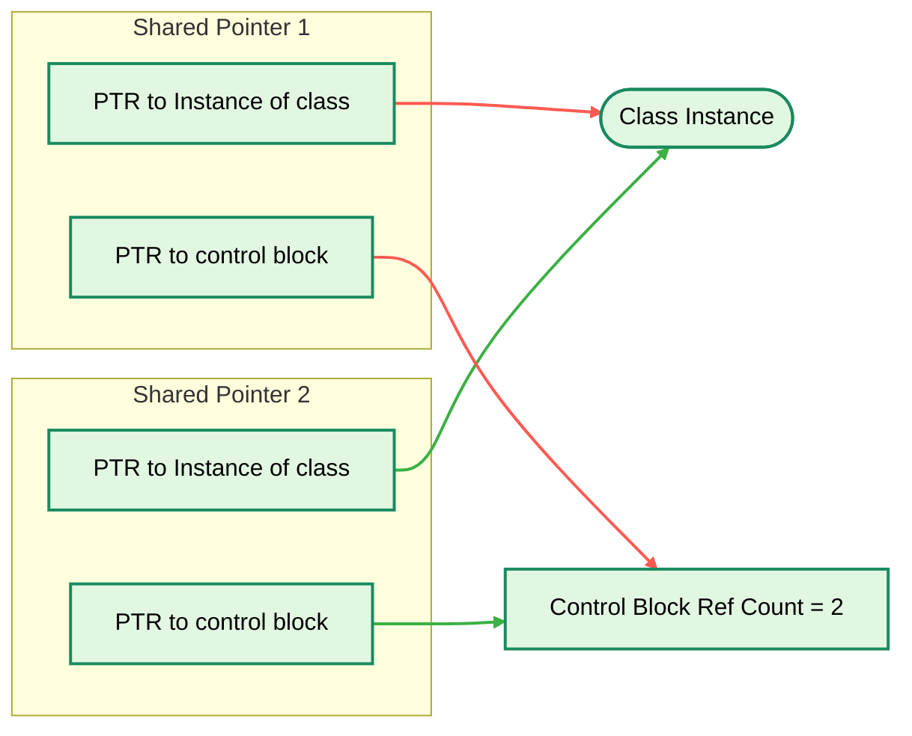

## 0.1 Brief introduction

`std::shared_ptr` is a [smart pointer](https://cppreference.com/cpp/memory#Smart_pointers) introduced in C++11 that enables multiple pointers to share ownership of the same dynamically allocated object. It uses reference counting to automatically manage the object's lifetime.
- Supports shared ownership of objects.
- Uses reference counting for automatic memory management.
- Eliminates manual memory deallocation.



## 0.2 How to create `std::shared_ptr`

### 0.2.1 Using new

For example:
```c++
std::shared_ptr<int> ptr(new int(10));
```

### 0.2.2 Using `make_shared`

For example:
```c++
std::shared_ptr<int> ptr = std::make_shared<int>(10);
```

`std::make_shared()` is preferred because it typically performs a single memory allocation and improves performance.

## 0.3 Differences between the two ways to create a `shared_ptr`

If we create a `shared_ptr` using `new`, there will be two memory allocations, one for the object, and another for the control block. The object and the control block are in different memory blocks. 

Things will be different if we create a `std::shared_ptr` with `std::make_shared()`. As mentioned above, `std::make_shared()` performs a single memory allocation. The object and the control block are in a single memory block.

**This may cause a difference when there is a `std::weak_ptr` referencing the same object**. Holding a `std::shared_ptr` creates a strong reference to the object, and `std::weak_ptr` causes a weak reference.

When a `std::shared_ptr` is created with `new`, the object and the control block live in two separate memory blocks.
Once the strong reference count drops to zero, the object is destroyed and its memory is freed. The control block is freed only when the weak reference count also reaches zero. Therefore there are two deallocations, which may happen at different times.

When creating a `std::shared_ptr` with `std::make_shared()`, there is only one memory allocation. When strong reference count drops to zero, the destructor is called, but the memory is not released until the weak reference count also reaches zero. The object's memory will be deallocated at the same time as the control block's memory deallocation because they are at one memory area allocated by one single memory allocation.

Here is an example:
```c++
#include <cstdio>
#include <cstdlib>
#include <memory>
#include <new>

using namespace std;

void* operator new(size_t n) {
    void* p = malloc(n);
    printf("    [alloc] %p %zu bytes\n", p, n);
    return p;
}

void operator delete(void* p) noexcept {
    printf("    [dealloc] %p\n", p);
    free(p);
}

void operator delete(void* p, size_t) noexcept { operator delete(p); }

struct Big {
    char buf[1024];
    Big() { printf("    Big() constructor\n"); }
    ~Big() { printf("    ~Big destructor\n"); }
};

int main()
{
    printf(" === scene A: make_shared(single alloc)===\n");
    {
        auto sp = make_shared<Big>();
        weak_ptr<Big> wp = sp;

        printf("-> sp.reset() (strong reference to zero)\n");
        sp.reset();
        printf("    expired = %d\n", wp.expired());
        printf("-> wp.reset() (weak reference to zero)\n");
        wp.reset();
    }

    printf(" === scene B: shared_ptr<Big>(new Big)===\n");
    {
        shared_ptr<Big> sp(new Big);
        weak_ptr<Big> wp = sp;

        printf("-> sp.reset() (strong reference to zero\n");
        sp.reset();
        printf("    expired = %d\n", wp.expired());
        printf("-> wp.reset()  (weak reference to zero)\n");
        wp.reset();
    }

    return 0;
}
```

Here is the output:
```bash
 === scene A: make_shared(single alloc)===
    [alloc] 0x1010ee820 1048 bytes
    Big() constructor
-> sp.reset() (strong reference to zero)
    ~Big destructor
    expired = 1
-> wp.reset() (weak reference to zero)
    [dealloc] 0x1010ee820
 === scene B: shared_ptr<Big>(new Big)===
    [alloc] 0x1010ee820 1024 bytes
    Big() constructor
    [alloc] 0x1010ed250 32 bytes
-> sp.reset() (strong reference to zero
    ~Big destructor
    [dealloc] 0x1010ee820
    expired = 1
-> wp.reset()  (weak reference to zero)
    [dealloc] 0x1010ed250
```

## 0.4 References

- [Are there any downsides with using make_shared to create a shared_ptr](https://stackoverflow.com/questions/2147600/are-there-any-downsides-with-using-make-shared-to-create-a-shared-ptr/2148225#2148225)
- [cppreference shared_ptr](https://cppreference.com/cpp/memory/shared_ptr)