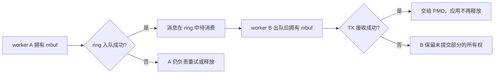
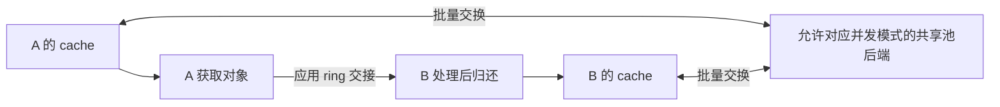

---
tags:
  - DPDK
  - 并发
title: 多 worker 与 mempool 并发假设
description: 队列调用拓扑、mbuf 所有权、mempool 并发标志与跨核回收
date: 2026/05/16
aliases:
  - "网络与DPDK/实践/多 worker 与 mempool 并发假设"
  - "articles/网络与DPDK/实践/多 worker 与 mempool 并发假设"
contentType: knowledge
showArticleMeta: true
modified: 2026-10-12
---

多 worker 数据面最容易混淆三件事：队列是否允许并发调用、mbuf 现在归谁、空闲对象能否从多个 lcore 放回 mempool。池支持并发，不代表同一个包可以被两个 worker 随意修改；每核有缓存，也不代表包必须回到最初分配它的核。

**范围**：以 DPDK 24.11 文档为参照；实际 PMD、mempool handler 和配置必须按部署版本核对。本篇解释同一进程的 worker 交接，不把普通指针 ring 自动推广成任意跨进程共享布局。

## 典型假设

| 对象 | 起步方案 | 必须核对 |
|---|---|---|
| RX queue | 一个 owner lcore 轮询 | PMD 的并发访问约定 |
| TX queue | 一个 owner lcore 提交 | 共享队列时是否支持相应能力 |
| mbuf | 成功交接后由新 owner 处理 | 不同时修改、不重复释放 |
| mempool | 按实际 get/put 并发配置 | handler、SP/SC 标志、cache 所有者 |
| ring | 按入队端和出队端分别计数 | SP/MP 与 SC/MC，而不是只数进程 |

多个线程并发访问同一 TX queue 的例外，应根据 PMD 的 `RTE_ETH_TX_OFFLOAD_MT_LOCKFREE` 能力判断；不能把它当作所有驱动的默认保证。见 [ethdev API](https://doc.dpdk.org/api-24.11/rte__ethdev_8h.html)。

## 1. mbuf 交接：成功与失败分开

这是应用约定的独占所有权模型；ring 本身不会自动修改 mbuf 引用计数或回收对象。入队失败时 A 仍负责对象；成功后 A 不应继续读写或释放。B 出队后可以处理或交给下一层。

假设 `rte_eth_tx_burst()` 提交 32 个包，返回 20：前 20 个交给 PMD；后 12 个仍由应用决定重试、缓存或释放。不能把整个数组全部 free，也不能只把成功数量计入统计后遗忘尾部。返回接收数量不表示每个包已完成线上发送。参见 [TX burst 的缓冲区管理语义](https://doc.dpdk.org/api-24.11/rte__ethdev_8h.html)。

## 2. mempool 与跨核释放

mempool 管理空闲对象；mbuf 的业务所有权则由应用和 PMD 协议决定。使用允许多生产者 put 的池时，B lcore 可以归还 A 分配的对象。**不存在通用的“必须回到原核 free”规则**。

`RTE_MEMPOOL_F_SP_PUT` 表示默认 put 使用单生产者假设；`RTE_MEMPOOL_F_SC_GET` 表示默认 get 使用单消费者假设。它们分别约束池操作方向，不是“对象创建者必须也是释放者”。多端同时 put 时，不应声明 SP；多端同时 get 时，不应声明 SC。调用显式 SP/SC 变体也需要同样审查。

每核 cache 减少访问后端共享池的频率；跨核流动会改变对象停留在哪个 cache 中，影响可用量与缓存局部性，但不能只用“有 per-lcore cache”证明操作非法。自定义 cache 也要有清楚的 owner，不能不加同步地供多个线程共用。见 [mempool API 的并发标志](https://doc.dpdk.org/api-24.11/rte__mempool_8h.html) 与 [mempool cache 说明](https://doc.dpdk.org/guides-24.11/prog_guide/mempool_lib.html)。

用回收 ring 把对象送回原 worker，是可以测量的局部性策略，也能收窄 put 的调用拓扑，但不是跨核 free 的必选修复。它会新增队列容量、回收延迟和失败路径；回收 ring 满时仍必须明确对象由谁持有。

## 3. rte_ring 标志与实际调用拓扑

`RING_F_SP_ENQ | RING_F_SC_DEQ` 只适用于一个串行入队端与一个串行出队端。如果 RX worker、定时任务和控制线程都可能入队，它就已经不是单生产者。

| 情况 | 常见并发模型 |
|---|---|
| 一个 RX owner → 一个处理 owner | SP / SC |
| 多个 RX worker → 一个处理 owner | MP / SC |
| 一个分发 owner → 多个消费者 | SP / MC |
| 多端提交和多端消费 | MP / MC |

默认 MP/MC 以及其他同步模式的适用条件应对照版本文档，不能笼统说“用了 CAS 所以任何调度方式都没问题”。bulk 与 burst 的失败语义也不同：bulk 是指定数量整体成功或失败，burst 可以只处理一部分；应用必须依据返回值转移对应数量的对象所有权。见 [DPDK Ring Library](https://doc.dpdk.org/guides-24.11/prog_guide/ring_lib.html)。

## 4. 配置和失败路径的审查样例

假设两个 RX worker A/B 共享池 P，各自向处理 worker C 的同一 ring 入队：

- P 的 get 路径有两个调用端，不能随意配置 SC get。
- A/B 和 C 都可能释放包，例如 RX 后丢弃、ring 入队失败、C 处理失败；P 的 put 拓扑不只是 C 一个端。
- 处理 ring 应按 MP/SC 审查；不要因为最终只有一个消费者就同时设 SP。
- 若 C 负责唯一 TX queue，仍需处理 TX 部分接受；未接受包继续归 C。
- 关闭时先停止新包与新交接，协调 worker，再清理残留对象。有人还持有 mbuf 时不能释放整个池。

这里的判断来自调用路径和所有权，而不是来自“有几个核”这一项配置。

## 5. 观测与排障

| 现象 | 优先检查 |
|---|---|
| 偶发重复 free / 包内容变化 | 成功交接后旧 owner 是否仍访问；引用计数与共享修改 |
| ring 满但内存不断减少 | 入队失败是否释放或保留对象；是否错误消费部分返回值 |
| 池 get 失败但别的核有缓存 | 每核 cache 囤积、池大小和处理/回收速度 |
| 多 worker 加入后损坏 | SP/SC 声明是否与实际调用端一致 |
| 停止时崩溃 | 队列、PMD 与应用仍持有的对象是否已协调回收 |

统计也有并发边界：worker 独写普通计数器，不代表主线程同时无同步读取就自动合法。采用原子计数、受控快照或停止后汇总，并记录各指标是精确值还是近似观测。

实践时记录 DPDK 版本、PMD、pool handler、cache 大小、ring 模式与队列 owner。先画出一个 mbuf 从分配到最终归还的所有分支，再讨论 NUMA 和批量优化；本文未提供实际吞吐数据。

## 相关阅读

- [[knowledge/通信与IPC/SPSC 共享队列：发布、消费与槽位回收]]
- [[knowledge/网络与DPDK/教程/DPDK 教程 3：多队列 + RSS + 多 worker 的最小转发 or Echo]]
- [[knowledge/网络与DPDK/实践/最小数据面项目设计]]
- [[knowledge/编程语言/C++/无锁编程]]
