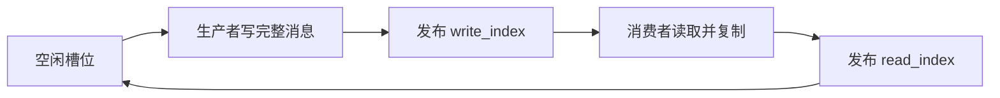
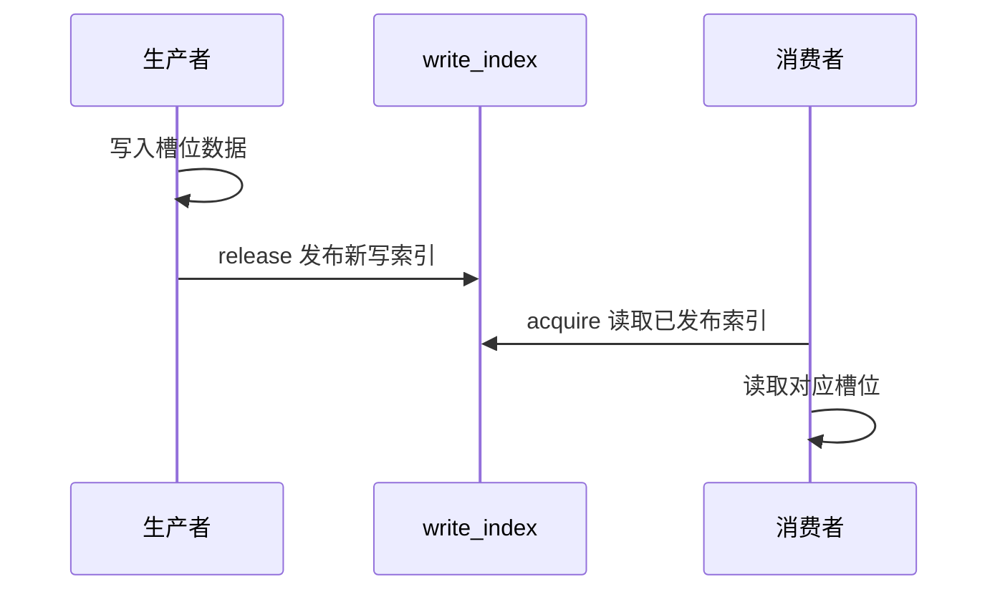
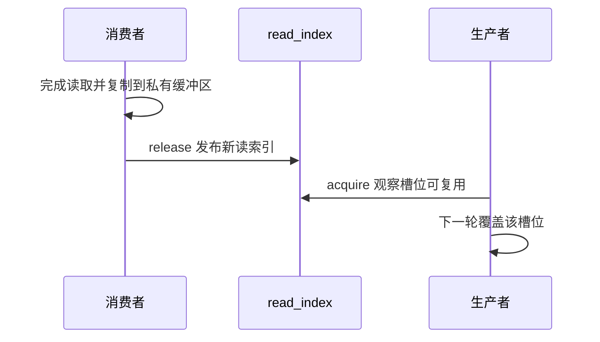

单生产者单消费者（SPSC，Single Producer Single Consumer）队列可以避免双方争抢同一个写索引，但并不意味着普通变量随意读写也安全。关键是两个方向的发布：生产者发布“数据已完整”，消费者发布“槽位已读完”。

本文用固定大小槽位和循环索引说明协议。它是算法层面的推导，适用于满足实现契约的共享内存环境；不是仅凭 C++ 线程示例就能成立的跨进程移植保证。

## 读完能带走什么

- 对每个共享字段说清唯一写者与读取方式。
- 区分消息发布和槽位回收两组同步关系。
- 判断容量、回绕、通知和异常退出是否仍遵守同一协议。

## 1. 先规定索引名字与不变量

本文的 `write_index` 指向生产者下一个写入槽位，`read_index` 指向消费者下一个读取槽位。其他实现可能用相反的 head/tail 命名；审查时看实际作用，不能靠变量名猜。

| 对象 | 唯一写者 | 另一端什么时候使用 |
|---|---|---|
| `write_index` | 生产者 | 消费者检查是否有完整数据 |
| `read_index` | 消费者 | 生产者检查是否可以复用槽位 |
| 当前可写槽位 | 生产者 | 发布写索引后消费者才能读 |
| 当前待读槽位 | 生产者最后写，消费者随后读 | 消费者发布读索引前不能覆盖 |

设数组有 `N` 个槽位，`N >= 2`，索引初始为 0。保留一个空槽，规定：

- 空：`read_index == write_index`。
- 满：`next(write_index) == read_index`。
- `next(i) = (i + 1) % N`。
- 实际容量是 `N - 1`，不是 `N`。数组大小为 64 时只能保存 63 条消息。

只有 `N` 为 2 的幂时，才可用 `(i + 1) & (N - 1)` 替代取模。不要把循环索引方案与“单调计数器相减”的满空规则拼在一起。

留空槽位、独立索引和发布顺序的内核参照见 [Linux Circular Buffers](https://docs.kernel.org/core-api/circular-buffers.html)。内核示例使用内核同步 API，不能直接把这些 API 当作用户态接口。

## 2. 第一组同步：先写载荷，再发布

一次入队的算法步骤：

1. 生产者读取自己维护的写索引 `w`，计算 `next(w)`。
2. 用 acquire 读取消费者发布的 `read_index`；若 `next(w)` 等于它，返回 FULL，且没有提交消息。
3. 将完整消息头、长度和载荷写入槽位 `w`。
4. 用 release 将 `write_index` 更新为 `next(w)`；这是本方案的提交点。
5. 按独立通知协议告知消费者检查队列。

消费者用 acquire 读取 `write_index`，确认不为空后，才能读取对应槽位。它观察到的发布必须覆盖所读消息，否则还不能据此使用载荷。

在目标实现契约下，这组配对让“先写消息，后发布索引”的顺序跨端成立。不能用 `volatile` 索引替代同步；也不能指望一次系统调用通知自动补全所有共享载荷的内存序。

## 3. 第二组同步：先读完，再允许覆盖

出队时不能一取得槽位就更新 `read_index`，然后把槽位指针交给应用慢慢读。生产者可能立刻复用该槽位，造成读取过程中被覆盖。

固定槽位复制版本应在私有复制完成后发布 `read_index`。如果需要借用槽位，出队与归还必须拆开；生产者只有在 release/ack 生效后才能复用。这会改变容量和背压语义，不能继续声称原来的 pop 就已经释放空间。

**两个 acquire 都有职责**：消费者读取写索引是为了看见数据；生产者读取读索引是为了确认消费者已读完。只保留前一组配对，无法证明复用安全。

## 4. 为什么槽位本身可以不是原子对象

在上述协议中，双方不会同时访问同一槽位且至少一方写：生产者先独占写，发布后消费者读，回收后生产者再次写。同步的索引建立槽位访问先后，避免对载荷每个字节都做原子操作。

前提仍包括：消息复制没有越界、提交前写完全部字段、消费者不在回收后继续持有槽位，以及索引使用已验证的原子实现。任一前提失效，非原子载荷都可能产生竞争。

独立的观测线程同时读取两个索引，得到的组合不一定是某一时刻的准确快照。用于粗略队列深度监控可以标明近似；不要把这种快照用于修改队列、判定对象可回收或重新初始化。

## 5. 真正的 SPSC 是调用拓扑

“只有两个进程”不等于 SPSC。客户端进程中若有两个线程同时 push，就有两个生产者；递归回调、信号处理程序中的提交也可能破坏唯一写者。

| 变化 | 能否继续直接使用该协议 |
|---|---|
| 一端多个线程，经同一锁串行调用 | 可以作为串行端点使用，但不是全路径无锁 |
| 多线程同时写入同一方向 | 不可以，需汇聚或专门的多生产者协议 |
| 消费者回调保留共享槽位指针 | 不可以立即回收，需借用协议 |
| 在运行中直接重置索引 | 不可以，可能覆盖未完成消息 |

建议把一个方向的调用入口固定到一个 owner 线程；双向通信使用两条队列。跨 worker 分片还需规定消息顺序和公平性。

## 6. 从线程算法到共享内存实现

上线前至少固定：CPU/架构、编译器和运行库、原子对象宽度与对齐、对象初始化方式、两端 ABI，以及映射内数据布局。

GCC 的原子操作在目标不能提供对应无锁序列时可能调用外部运行库函数；不能假定这种回退自动具备跨进程同步能力。`is_lock_free()` 或对应内建函数是核对的一部分，不能替代整套实现与布局契约。见 [GCC atomic builtins](https://gcc.gnu.org/onlinedocs/gcc/_005f_005fatomic-Builtins.html)。

槽位内使用值与相对偏移，不放进程私有指针。线程示例中的 `std::vector`、分配器和析构机制不能直接成为共享布局。初始化与进程重启见 [[knowledge/linux/内核机制/POSIX 共享内存：初始化、同步与生命周期]]。

## 7. 批量、缓存行与故障边界

- **批量发布**：生产者写完一批后一次更新索引，可减少同步次数，但消费者必须只读取已发布范围；故障时未发布的一批不得被当作完整消息。
- **缓存行布局**：可分离两端频繁写的索引，减少伪共享（false sharing）。不要把 64 字节当作所有平台的固定缓存行大小。
- **暂停与死亡**：消费者停顿会形成背压；索引没有锁也不能让生产者绕过未回收槽位。
- **异常退出**：若一端死亡，不在存活进程还访问旧区时直接清零；由会话代际与协调退出协议决定恢复。

本队列协议只解决槽位交换。它不自动解决通知丢失、超时请求的业务结果、跨重启去重或零拷贝对象回收。

## 8. 手工审查与实验设计

以 `N=4` 举例，实际容量 3：初始索引均为 0，生产者连续提交三条后写索引为 3；下一条应返回 FULL。消费者复制一条后读索引变为 1，生产者才能写槽位 3 并回绕为 0。

验收时检查消息序号、长度和载荷内容，并分别让两端暂停：

- 满队列返回失败时不能改变提交状态。
- 消费者暂停在复制中途，生产者不能覆盖它的槽位。
- 写完载荷但尚未发布时，消费者不能提前看到这条消息。
- 回绕多轮后保持无重复、无遗漏和有界容量。

以上是推导和实验要求，尚无板级测试结果。下一步接入 [[knowledge/通信与IPC/共享队列通知：eventfd、futex 与防丢唤醒]]；先保证正确性再优化睡眠与批量策略。
