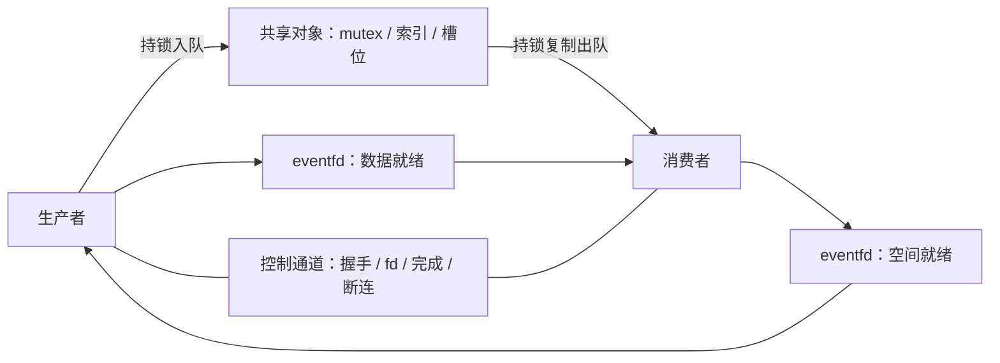
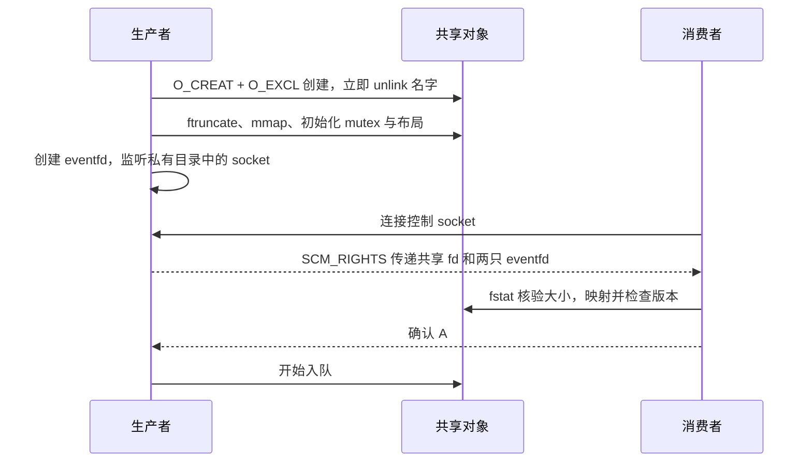
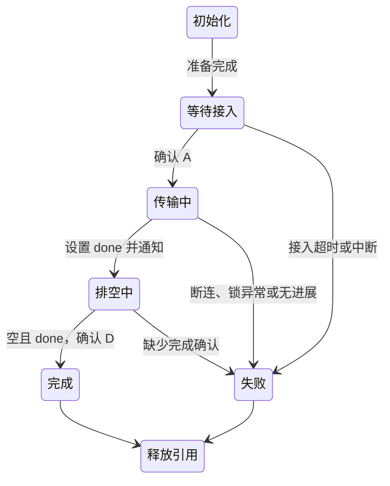

本篇将共享对象、队列和通知接成具体示例。源码位于仓库 `labs/shared-memory-ipc/demo.c`，构建说明在同目录 `README.md`。该目录不由 Quartz 发布，需从仓库取得源文件。

**环境**：Linux、C11、支持健壮进程共享 mutex 的 pthread 实现。两端运行同一构建产物，属于同用户的可信进程。本例使用 Linux 的 eventfd，不能直接在 macOS 运行。当前作者环境为 macOS，尚无 Linux 编译与运行记录；以下输出是预期，不是执行记录。

## 读完能带走什么

- 将初始化完成与消费者接入串成明确的握手。
- 用有锁队列建立正确性基线，处理满队列与正常收尾。
- 在持锁进程死亡时让会话失败，区分失败退出与数据恢复。

## 1. 最小范围

| 项目 | 本例设置 |
|---|---|
| 拓扑 | 两个独立启动的进程，一条单向队列 |
| 消息 | 一个 64 位序号，从 0 连续递增 |
| 容量 | 8 个槽位；head、tail、count 由同一 mutex 保护 |
| 同步 | 进程共享 robust mutex |
| 通知 | 数据就绪和空间就绪各一只 eventfd |
| 控制面 | Unix 域 SOCK_SEQPACKET、fd 传递、接入和完成确认 |

本例使用 count 区分满空，实际容量为 8；它不是 [[knowledge/通信与IPC/SPSC 共享队列：发布、消费与槽位回收]] 中留一个空槽的无锁方案。

载荷通过共享区交换，通知让等待端重新检查状态。控制通道不承载每条数据消息。

## 2. 初始化后才传递 fd

消费者若自行按名字打开对象，可能撞上“名字已创建，大小与同步对象尚未初始化”的阶段。本例由唯一创建者完成准备后，通过控制通道发送对象引用。

`SCM_RIGHTS` 传递文件描述符引用，消费者收到的 fd 数字可以不同。不是复制发送端的整数就能访问资源。见 [Unix 域 Socket 的描述符传递](https://man7.org/linux/man-pages/man7/unix.7.html)。

`shm_unlink()` 删除名字，已有 fd 和映射仍保持对象；后续通过 fd 接入，避免旧名字被下一次会话误用。见 [shm_open 与 shm_unlink](https://man7.org/linux/man-pages/man3/shm_open.3.html)。magic/version 与对象大小仅识别本例布局，不提供跨版本序列化或不同 libc 的兼容保证。

## 3. 协议与源码函数的对应

| 函数 | 职责 |
|---|---|
| `initialize()` | 准备共享区、锁和通知 fd |
| `send_descriptors()` / `receive_descriptors()` | 握手与 fd 检查 |
| `lock_queue()` | 有界获取锁，拒绝损坏或死亡 owner 状态 |
| `notify()` / `wait_change()` | 通知、断连与截止时间 |
| `producer()` / `consumer()` | 槽位交换和完成协议 |
| `cleanup()` | 释放引用和创建者自己的临时 socket |

生产者持锁检查 count，未满才写槽位、移动 tail 并增加 count。解锁后通知消费者；满时不覆盖旧消息，而是等待空间通知。醒来再次检查，不能把通知当作已预留空间。

消费者先在锁内把消息复制到私有变量，再移动 head、减少 count；解锁后通知生产者。后续核对序号使用私有副本，不继续访问已归还的共享槽位。

默认 eventfd 读取累计计数并清零，计数不等于队列条目数。只有指定的一端读取各自的通知 fd；每次读取后必须回到队列检查。见 [eventfd](https://man7.org/linux/man-pages/man2/eventfd.2.html)。

## 4. 正常完成与突然断连

生产者设置 done 后，消费者先处理剩余消息，再发送 D。生产者收到确认并核对累计消费数量，才输出 complete；突然 EOF 不算正常完成。

等待通知时也观察控制通道，避免对端已经死亡却只盯着 eventfd。通知前生产者死亡时，依赖断连或等待截止退出；本例不承诺每条已提交消息都必然交付。

## 5. robust mutex 采用整代失败策略

遇到 `EOWNERDEAD` 时调用者已获得锁，但共享数据可能只更新了一半。本例标记失败并解锁，不调用 `pthread_mutex_consistent()`，拒绝继续消费不可信状态。

未声明 consistent 就解锁会使锁不可恢复，后继可能得到 `ENOTRECOVERABLE`。这是明确的 fail-stop 策略，不是恢复。需要就地修复的产品应另行定义提交标记、代际与业务不变量。见 [robust mutex 状态语义](https://man7.org/linux/man-pages/man3/pthread_mutexattr_setrobust.3.html)。

活着但一直持锁的进程，由 trylock 与单调时钟等待上限处理。SIGINT / SIGTERM 的处理器只设置退出标志，主路径负责清理；SIGKILL 不执行清理，可能遗留本例打印出的临时 socket 目录。确认原会话退出后才处理该目录。

## 6. Linux 上的使用步骤

1. 在仓库 `labs/shared-memory-ipc/` 中执行 `make`，生成 `demo`。
2. 终端 A 执行 `./demo producer 100`。
3. 将输出的 `./demo consumer /tmp/adrian-ipc-XXXXXX/control.sock` 完整命令复制到终端 B，在 30 秒内执行。
4. 预期消费者输出 `consumer: received=100 complete`；生产者输出 `producer: sent=100 full_observations=... complete`。
5. 完成后执行 `make clean`。

`full_observations` 仅是发现队列满的次数，允许为 0；不是丢消息数量，也不是准确阻塞时长。消息数上限为 1000000，不会随参数增大共享队列容量。

示例固定的 5 秒等待时限不是产品 deadline 建议；锁等待和事件等待分开后，总操作时间不能简单等同于一次 poll 的时限。

## 7. 已实现与待验证

| 已提供源码 | 尚未提供 |
|---|---|
| 固定槽位、序号核对、背压 | 双向 RPC、变长载荷、对象池 |
| 独立进程握手与 fd 传递 | 自动重连、跨版本升级 |
| 断连、有界等待、失败退出 | 崩溃必达、就地恢复、跨重启幂等 |
| 构建文件和运行步骤 | Linux 执行记录、板级结果、性能数字 |

后续先取得 Linux 构建与运行记录，再扩展消息类型或借用接口。基础协议见 [[knowledge/通信与IPC/共享内存通信框架：协议、队列与故障恢复]]；等待时序见 [[knowledge/通信与IPC/共享队列通知：eventfd、futex 与防丢唤醒]]。
