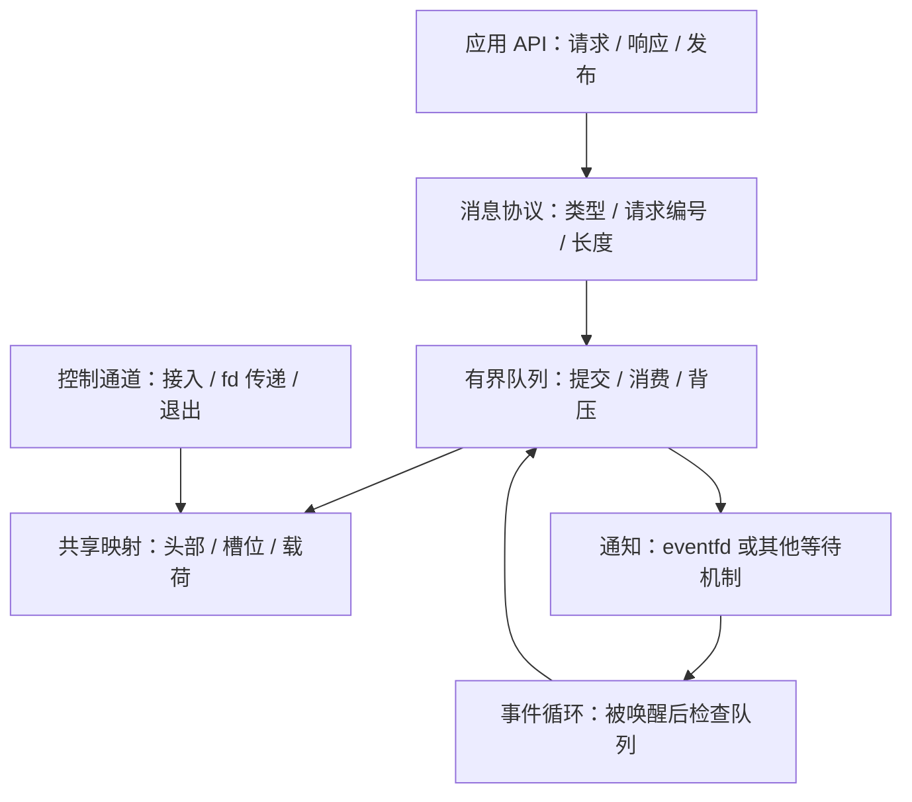
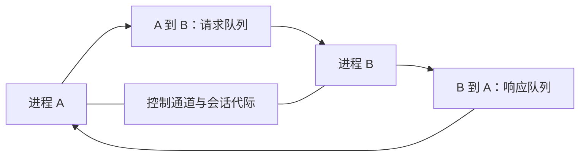
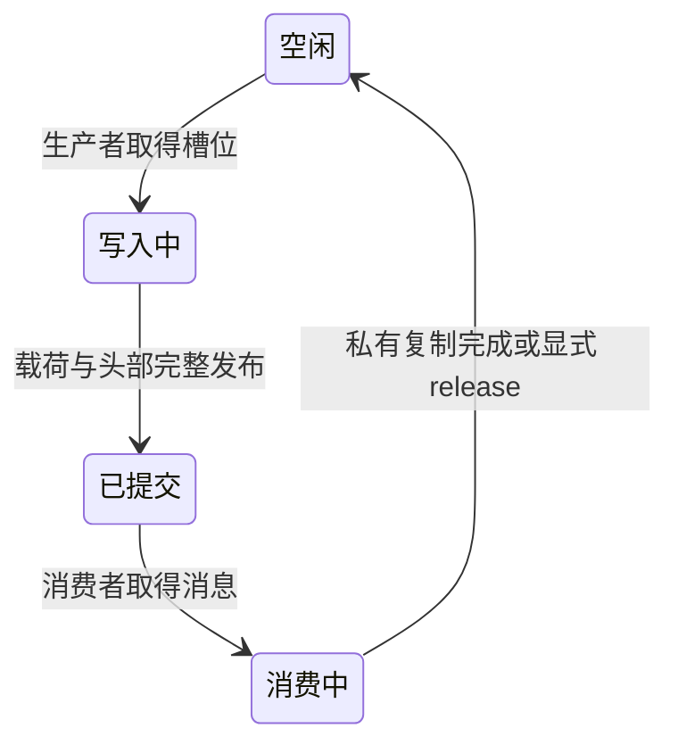
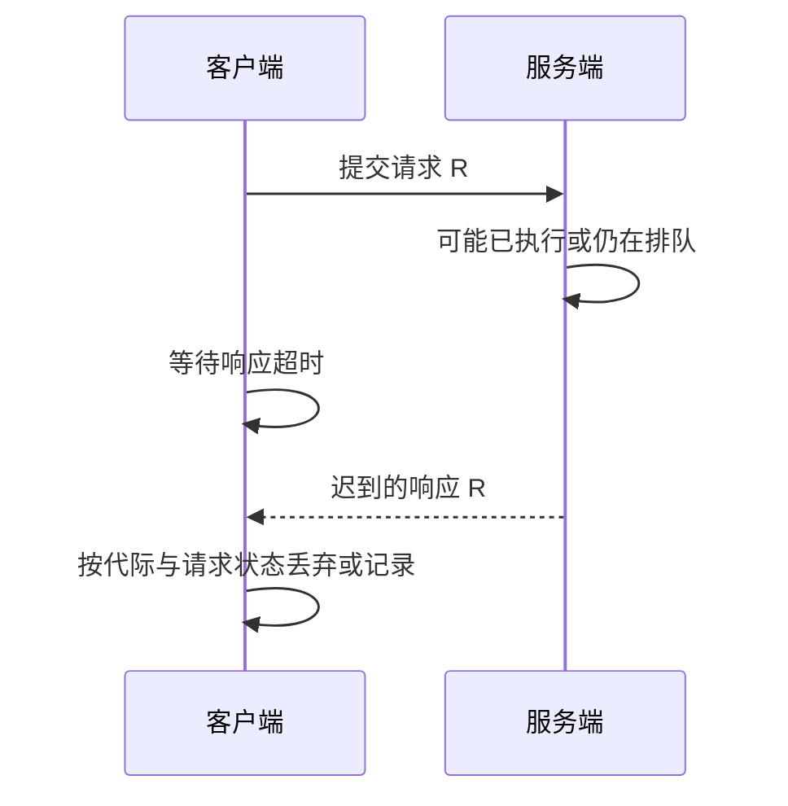

把字节写进共享内存只是数据传输的一步。通信框架还要定义消息何时算提交、队列满了怎么办、请求超时是否仍可能执行，以及进程重启后哪些资源还能使用。

本文给出一套**同机、同 ABI、可信进程之间**的设计基线：固定容量队列、进程共享 mutex、独立控制通道。它用于拆解职责与指导实现，不宣称是已完成性能验证的生产框架。

## 读完能带走什么

- 画出控制面与数据面的边界，避免把 fd、指针或锁状态误当消息格式。
- 定义提交、消费、完成和释放四个不同事件。
- 给背压、超时、断连和重启分别规定行为。

## 1. 框架分层：谁承担哪种保证

| 层 | 负责 | 不能自动保证 |
|---|---|---|
| 共享映射 | 各进程访问同一对象 | 初始化完成、读写互斥 |
| 队列 | 槽位归属、提交与消费 | 请求已经完成业务操作 |
| 通知 | 让等待者检查状态 | 一次通知对应一条消息 |
| 请求协议 | 匹配响应、识别超时 | 超时请求没有执行 |
| 业务层 | 幂等、事务和结果含义 | 仅靠 transport 实现跨重启 exactly-once |

控制通道可以用 Unix 域 Socket，传递 fd 时使用 `SCM_RIGHTS`；接收方得到的是本进程可使用的描述符，不是发送方 fd 整数的直接复用。参见 [Unix 域 Socket 的描述符传递](https://man7.org/linux/man-pages/man7/unix.7.html)。

## 2. 从一对进程开始约束拓扑

先为 A → B 和 B → A 各建立一条队列：请求与响应方向独立，避免双向争夺同一个队头。每条队列的生产者和消费者数量必须明确。

如果 A 中有多个线程能提交，A → B 就不是 SPSC。可以先由进程内互斥或专门提交线程汇聚，再进入队列；不要因为只有两个进程，就假定只有一个生产者。

在改成多生产者多消费者（MPMC，Multi Producer Multi Consumer）之前，先明确全局顺序是否必要。每个 worker 独立队列可减少共享写入，但也需要调度、公平性和每队列容量策略。

## 3. 消息格式与布局边界

建议第一版把载荷放进固定大小槽位，允许一次明确的复制。这样无需同时处理跨进程对象池、引用计数和零拷贝回收。

| 字段 | 用途 | 检查要求 |
|---|---|---|
| `version` | 识别布局或协议版本 | 不兼容就拒绝接入 |
| `generation` | 标识当前共享对象与会话 | 重启后不得接受旧代际响应 |
| `type` | 消息类型 | 未知类型有明确处理策略 |
| `request_id` | 关联请求与响应 | 在同一代际与未完成请求集合内唯一 |
| `payload_length` | 限定载荷 | 不超过槽位上限和映射边界 |
| `status` | 响应结果 | 区分业务错误、协议错误和传输失败 |

使用固定宽度整数，明确字节序和对齐。检查边界时用“长度是否小于等于剩余空间”的方式，避免 `offset + length` 整数溢出。共享布局不要包含私有地址、进程内锁、带动态分配状态的 C++ 对象。

校验消息本身也不能隔离不可信写者：对方可以在检查之后修改共享区。可信进程之外的边界需要权限隔离、私有快照或重新选择传输方式。

## 4. 有界队列：先用锁证明不变量

基线布局可以保存 `capacity`、`head`、`tail`、`count` 和槽位数组。`head`、`tail` 在容量范围内循环，`count` 在 0 到容量之间；所有修改由同一个进程共享 mutex 保护。

| 操作 | 持锁时的步骤 | 完成条件 |
|---|---|---|
| 入队 | 检查未满 → 填槽位 → 更新 tail 与 count | 提交后消费者能取得完整消息 |
| 出队 | 检查非空 → 复制到消费者私有缓冲区 → 更新 head 与 count | 原槽位可再次使用 |
| 满队列 | 不覆盖未消费槽位 | 返回 WOULD_BLOCK 或进入明确等待策略 |
| 空队列 | 不读无效槽位 | 返回 EMPTY 或等待后重新检查 |

这里**出队后允许复用槽位，是因为消费者已复制消息**。如果应用持有槽位指针异步处理，必须另外提供 release/ack 协议，不能在出队时就把槽位交还生产者。

这张图也是崩溃恢复的审查工具：每次进程死亡发生在哪个状态，谁有权判定槽位可重新使用？只有锁而没有恢复元数据，无法完整回答这个问题。

## 5. 零拷贝引入的是生命周期协议

零拷贝（zero-copy）通常让消息携带共享对象池中的偏移与长度。生产者、队列、消费者之间传递的是访问权，载荷并不因通知发送就自动安全。

需补充：分配所有者、引用或借用规则、重复释放检测、消费者崩溃回收、代际隔离，以及超时请求的载荷能否仍被服务端访问。

建议先测固定槽位复制版本的载荷大小分布、吞吐和尾延迟；当复制确实占据明显成本时，再引入对象池。不要只把 `memcpy()` 删除就宣称系统完成了零拷贝设计。

## 6. 背压与通知分别设计

背压（backpressure）限制生产速度，通知降低空队列轮询开销。第一版可以在每次成功入队后发送通知，消费者被唤醒后排空可处理消息，再回到等待。

`eventfd` 默认读出累计计数并清零；使用 `EFD_SEMAPHORE` 时语义不同。通知计数与消息数不必保持一一对应，应以队列状态为准。通知 fd 的读写失败也必须进入错误处理，不能让“消息已提交但通知失败”悄悄变成永远睡眠。见 [eventfd](https://man7.org/linux/man-pages/man2/eventfd.2.html)。

| 满队列策略 | 适用情况 | 需要明确的边界 |
|---|---|---|
| 返回失败 | 调用者可重试或降级 | 是否已提交，不能模糊返回 |
| 有限等待 | 请求需要限时完成 | 截止时间、唤醒条件、停止事件 |
| 丢弃新消息 | 允许采样损失的遥测 | 丢弃计数、优先级 |
| 合并更新 | 只关心最新状态 | 哪些消息可以覆盖，不能覆盖事务请求 |

响应队列也会满。服务端不能在持有共享锁时等待响应空间，也不能阻塞唯一负责消费响应的客户端线程，形成相互等待。至少把“生产响应”与“释放请求资源”的失败路径写清楚。

## 7. 超时、重试与请求结果

“提交成功”只表示框架接受请求；“超时”只表示客户端没有在截止时间内拿到结果。业务可能已执行。取消请求也通常是尽力取消，除非服务端协议能证明执行尚未开始或已被终止。

重试非幂等操作应使用业务幂等键（idempotency key），而不只是重新分配一个 `request_id`。去重状态若只在易失内存里，服务端重启后也会丢失；不能据此承诺跨重启恰好执行一次。

请求表至少区分 PENDING、COMPLETED、TIMED_OUT、CANCELLED；迟到响应不能写入已经释放的等待对象。超时所释放的本地句柄与共享载荷所有权需要分别处理。扩展阅读见 [[knowledge/网络与DPDK/实践/RPC 技术与分层详解]]。

## 8. 崩溃与重启：隔离代际

将代际编号绑定到共享对象和控制连接。监督方发现对端退出后，先让当前会话进入失效状态，停止新的提交，再处理未完成请求与共享区恢复。

- **共享 mutex 持有者死亡**：用 robust mutex 发现并按规则修复数据；不能只调用 consistent 就忽略半写槽位。
- **无锁生产者死亡**：可能留下已预留未提交的位置，需要专门的恢复设计；不能直接“跳过 tail”。
- **同名对象重建**：新旧映射是不同对象；新会话必须握手新代际，旧响应不能混入。
- **PID 重用**：PID 只能是诊断信息，不能单独作为永久身份或有效会话凭证。

共享对象的初始化与释放细节见 [[knowledge/linux/内核机制/POSIX 共享内存：初始化、同步与生命周期]]。

## 9. 把设计落实成一份最小接口契约

下面的数字仅是便于实现的实验配置，不是性能建议：每方向 64 个槽位，每槽最多 256 字节载荷，两条队列各用一把进程共享 mutex。禁止并发重建和运行中扩容；只支持同一构建版本的两个可信进程。

- `try_send(message)`：队列满返回 `WOULD_BLOCK`，**保证本次未提交**；版本或代际不符返回 `SESSION_INVALID`；成功后请求可能执行，不能再按“未发送”处理。
- `try_receive(out)`：把槽位载荷复制到私有 `out` 后回收槽位；空队列返回 `EMPTY`。返回时应用只持有私有数据。
- `call(request, deadline)`：提交前过期可以保证未提交；提交后过期只能返回 `RESULT_UNKNOWN`，不能承诺业务未发生。
- `close_session()`：停止新提交，让未完成调用得到明确失败结果；协调对端停止访问后才回收映射。

例如当前会话 `generation=9`，客户端发出 `request_id=17`、`type=READ_COUNTER`。队列提交成功后，即使通知暂时失败，也不能再次无条件提交同一业务操作。服务端返回时携带同一代际和请求编号；客户端若已超时，只能按迟到响应策略处理，不能访问已经释放的等待对象。重建为 `generation=10` 后，任何代际 9 的响应都不得完成新会话请求。

对有副作用的 `INCREMENT_COUNTER`，提交后超时返回未知结果；调用者若重试，必须携带同一业务幂等键，服务端也必须具备对应去重协议。`request_id` 负责关联一次调用，幂等键负责识别一次业务意图，两者职责不同。

## 10. 观测指标与最小验收

| 维度 | 至少记录 |
|---|---|
| 容量 | 队列深度、高水位、入队失败次数 |
| 延迟 | 排队、处理、端到端分别计时，报告 p50 / p99 |
| 生命周期 | 当前代际、接入次数、重建次数、未完成请求数 |
| 错误 | 超时、迟到响应、通知失败、恢复失败 |
| 载荷 | 大小分布、复制字节数、零拷贝对象占用 |

实验按正常收发 → 队列满 → 消费者慢 → 持锁者死亡 → 对端重启 → 迟到响应推进。检查序号、结果与资源回收，而不是仅以“运行一小时没崩”判断正确。

本文尚未包含实测数字。后续最小实现应固定容量、载荷上限、两个独立进程和同步方式，并与相同语义的 Unix 域 Socket 实现对照；测量时记录内核、CPU、libc、编译选项和绑核设置。
