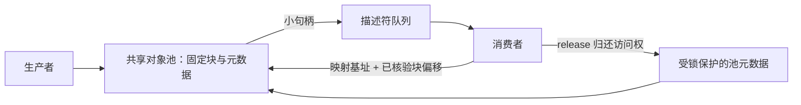
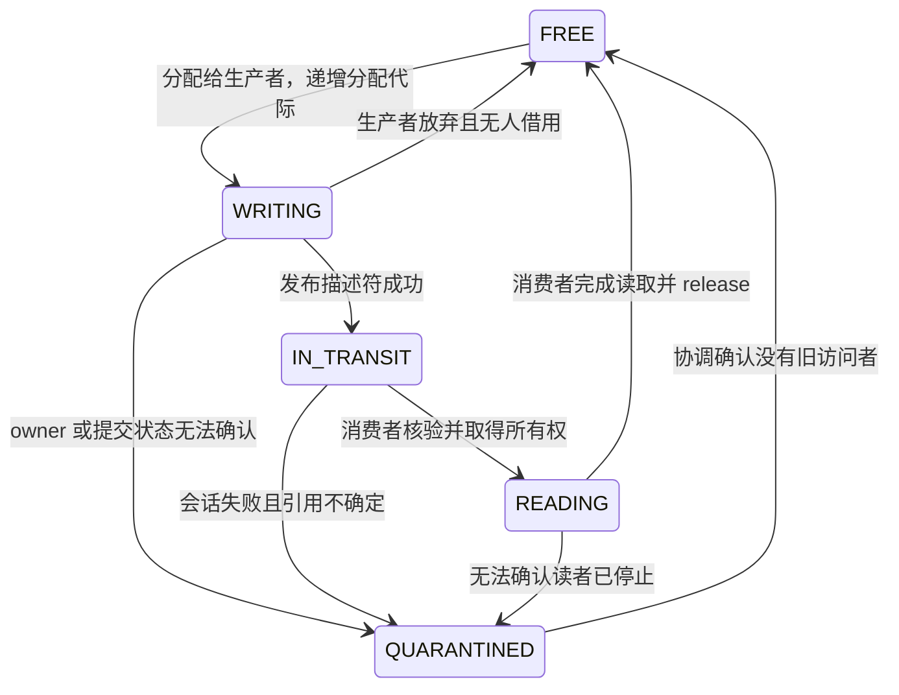
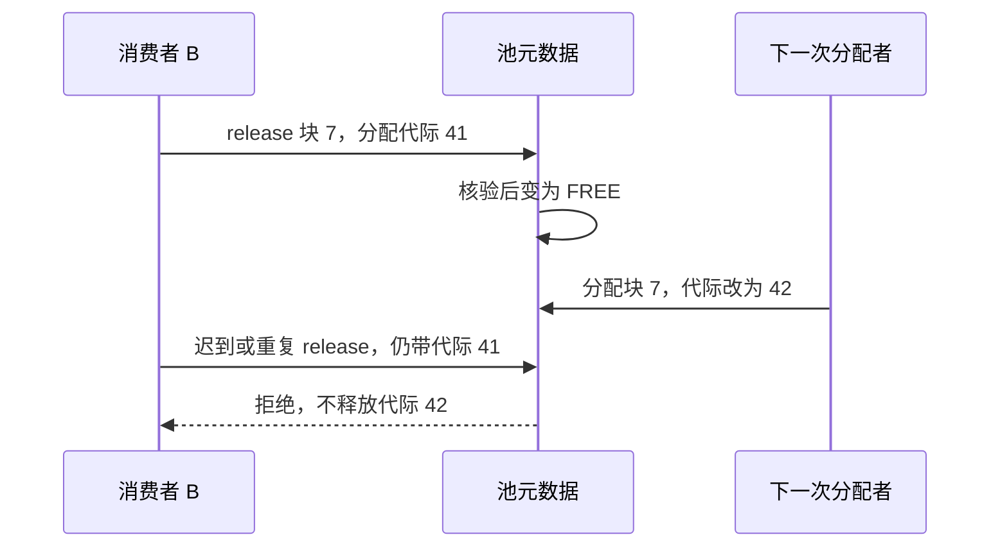
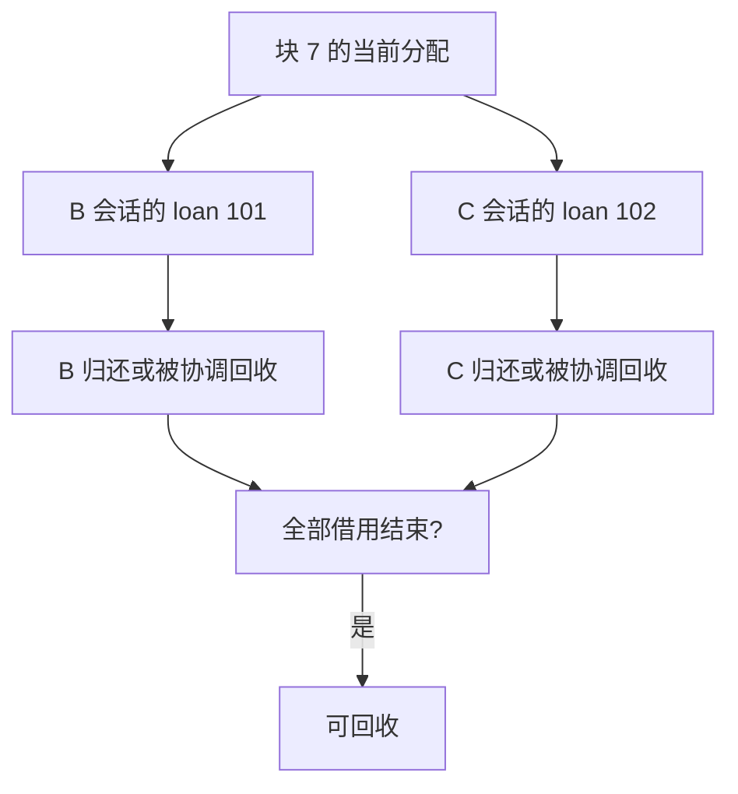

固定槽位队列在出队时复制载荷，消费者处理私有副本，原槽位就能复用。改成零拷贝（zero-copy）后，消费者可能仍在读取共享载荷；如果仍按“出队即释放”处理，对象会被下一条消息覆盖。

本文给出一个**有锁、固定块、单一所有者交接**的设计基线，先说明安全回收，再扩展多读者借用。它是协议设计，不是已完成实现与性能验证的对象池。

## 读完能带走什么

- 用句柄而非私有指针描述跨进程载荷。
- 把队列槽位回收和载荷块回收分开。
- 判断超时、重复 release 和进程死亡是否允许复用内存。

## 1. 对象池、队列与映射各是什么

描述符队列可以很快回收自己的槽位，但消费者对载荷的访问权可能持续更久。两个资源不能共用一个“已经消费”的标志。

POSIX 共享内存只提供共享对象的创建、映射与引用生命周期；对象池的分配、归属和回收由应用协议实现。参见 [POSIX 共享内存](https://man7.org/linux/man-pages/man7/shm_overview.7.html)。

## 2. 一个可审查的句柄格式

以区域内 128 个固定大小块为例，描述符至少包含：

| 字段 | 职责 | 核验 |
|---|---|---|
| `region_generation` | 标识当前区域实例 | 不接受旧映射代际 |
| `block_index` | 定位固定块 | 小于池块数 |
| `allocation_generation` | 标识该块本次分配 | 与当前元数据一致 |
| `transfer_id` | 标识本次所有权转移 | 与待交接记录匹配 |
| `payload_length` | 限定可读范围 | 不超过块大小与映射边界 |

偏移由已核验的布局和 block_index 计算，不直接信任任意地址。检查算术溢出、元数据区与载荷区边界，以及布局版本。各进程用自己的映射基址换算地址。

区域代际和分配代际不同：区域不变时，块也会被重复分配。只检查区域代际，无法识别上一轮分配留下的迟到 release。

计数器回绕也要有规则：分配代际即将耗尽时，停止复用该标识空间并协调更换区域代际；不能以“64 位应该够用”替代永久唯一性保证。

## 3. 单一所有者交接状态机

第一版用同一把区域 mutex 保护池元数据与描述符提交，使“改变所有权”和“发布可消费句柄”成为同一个受锁操作。载荷写入期间不必一直持锁，但只能由当前 WRITING owner 访问；提交前必须完成写入。

| 操作 | 失败时的所有者 |
|---|---|
| 分配无空闲块 | 未取得对象 |
| 描述符队列满，提交未发生 | 生产者仍持有 WRITING 对象，可重试或放弃 |
| 发布成功但通知失败 | 对象已 IN_TRANSIT，不能按提交失败直接 free |
| 消费者接入或核验失败 | 进入明确失败/隔离流程，不能随意归还句柄指向的块 |
| 应用处理失败 | 若消费者已经取得对象且访问结束，仍需归还 |

这里的共享锁负责载荷写入完成到消费者取得访问权之间的同步；通知只负责让对方检查队列。以后拆成无锁池与无锁队列时，必须重新推导跨结构提交协议，不能照搬此状态机后删掉锁。

## 4. release 必须检查本次访问权

在池锁内核验区域、块、分配代际、transfer_id、当前 READING 状态和 owner，全部一致且消费者已经停止使用，才允许变为 FREE。

同一代际下重复 release 也要由状态或释放记录识别，不能盲目给引用计数减一。重复收到描述符时，IN_TRANSIT → READING 的状态转换只允许一次，避免无意制造第二个借用者。

代际检查**不能阻止旧裸指针直接读写**已经复用的地址；它仅约束通过协议提交的操作。因此应用不得在 release 后继续保存和使用共享区指针。

## 5. 借用接口怎样约束调用者

可以把应用接口拆成 `receive()` → 有限生命周期的 `view` → `release(view)`。view 保存句柄和本地映射引用，所有权不可隐式复制；若要转交线程，必须移动这份访问权或显式建立新借用。

关闭会话时先停止新 view，等待或协调终止现存借用，再撤销本进程映射。不能先 munmap，再让析构函数用旧地址归还对象。

C++ 的 RAII 可以帮助正常路径归还，但不能代替 SIGKILL 后的跨进程恢复，也不能证明异步任务已经不再使用数据。自动 release 的对象生命周期必须覆盖异步读取的实际结束点。

## 6. 多读者需要逐份借用，而非裸引用计数

载荷在发布给多读者之后应保持只读，直到所有借用结束；若读写并发，必须另外定义版本或同步协议。

假设向 B、C 发布同一块：为每份借用创建 `(owner_session, loan_id)` 记录，发布与登记借用必须有原子性边界。每个 release 只结束对应的一份有效借用；所有借用结束后才能复用。

如果先把引用计数设为 2，再发布第二份时失败，必须回滚那份未发出的借用。重复归还不能减两次；消费者重启也不能继承上一会话的 loan_id。锁或事务式元数据处理用于维护这些规则，计数只是结果，不是完整协议。

## 7. 超时与进程死亡不自动授权回收

客户端请求超时，服务端仍可能读共享载荷。超时释放等待句柄与回收载荷是两件事：业务层可以停止等待，但池必须等访问者明确归还，或由协调机制确认所有旧访问者停止。

心跳丢失只能说明没有及时观测到活动；读者可能只是被暂停。直接按 TTL 复用其内存，会让恢复运行的进程访问下一代数据。

安全策略可以选择：等待现存会话确认退出；确认进程及其可能持有引用的协作者终止；或隔离旧区域并为新会话分配新区域。区域轮换会增加资源占用，也必须限制旧代数量。

这里只给出有锁可信进程模型的回收约束；不提供任意进程失联后仍保证无损继续运行的算法。

## 8. 零拷贝到底省了哪次复制

必须指定边界：生产者直接在共享块编码载荷，队列只传小句柄，消费者直接读取，可省掉出队时的载荷复制；若生产者先从私有缓冲区 memcpy 到共享区，这次复制仍存在。

至少记录载荷大小分布、复制字节数、块占用高水位、最长借用时间、分配失败、重复归还、隔离块与旧代区域数量。吞吐提高但长借用耗尽池，也可能使尾延迟恶化。

对固定槽位复制版和池借用版使用相同业务语义、负载和背压条件对照；本文没有实测数字。

## 相关阅读

- [[knowledge/通信与IPC/共享内存通信框架：协议、队列与故障恢复]]
- [[knowledge/通信与IPC/共享内存双进程实践：握手、背压与退出]]
- [[knowledge/网络与DPDK/实践/多 worker 与 mempool 并发假设]]
