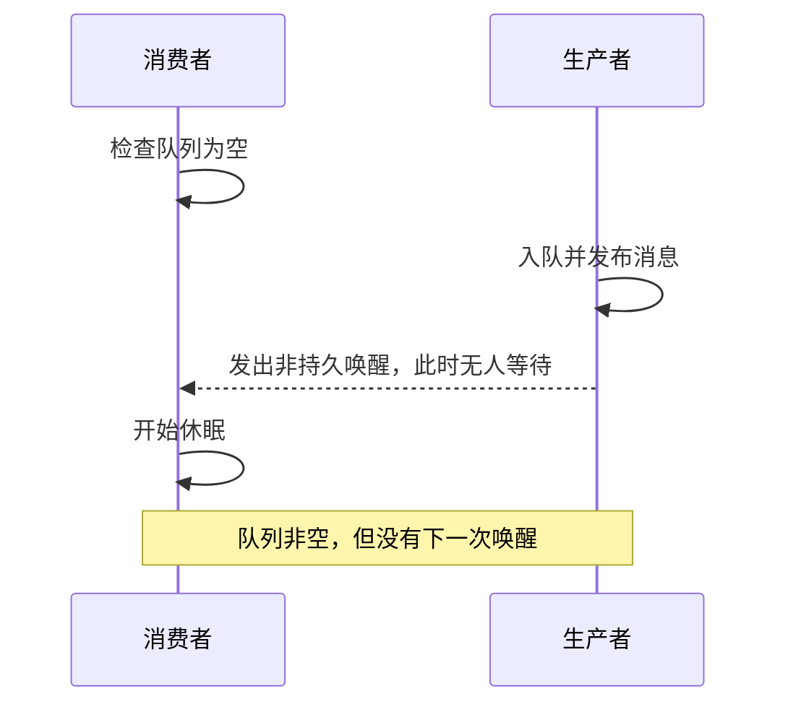
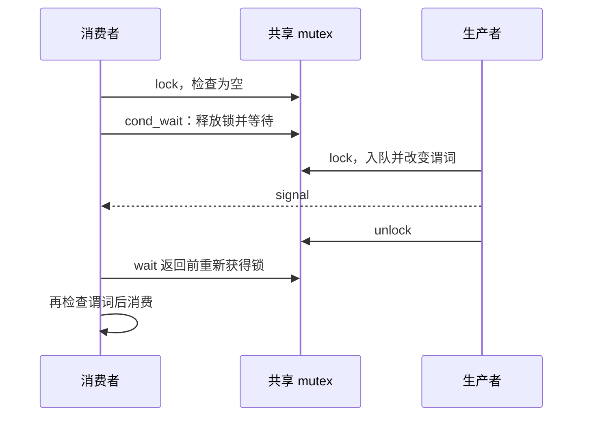
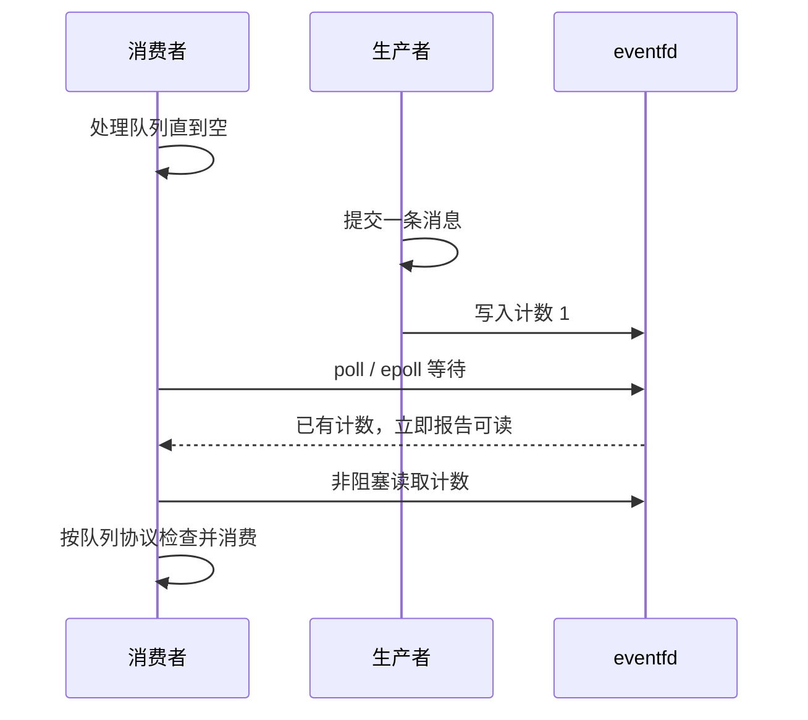
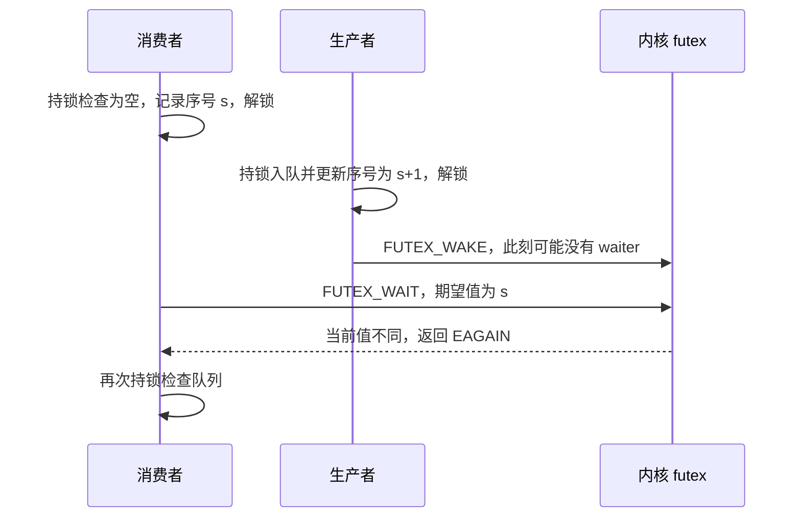

队列协议可以保证已提交消息完整，但消费者在“看见队列为空”和“进入等待”之间仍有一个窗口。若生产者只发一次没有持久状态的唤醒，消息可能留在队列中，消费者却一直睡眠。

本文区分条件变量（condition variable）、`eventfd` 和 futex。目标是先建立可说明的等待协议，不设计未经证明的 lock-free 睡眠优化。

## 1. 最小反例：检查和等待分离

图中的错误不是载荷缺少屏障，而是等待条件与进入等待没有可靠连接。需要原子释放锁并等待、可保留的通知计数，或“比较状态再睡眠”的机制。

通知和数据同步各自负责一部分：即使收到了通知，也必须用队列规定的锁或 acquire 操作取得数据，不能把唤醒本身当作任意用户态数据的发布保证。

## 2. 条件变量：用同一 mutex 保护谓词

最容易审查的基线是让队列状态、停止标志与条件变量使用同一把进程共享 mutex。

消费者持锁检查 `queue_not_empty || stopping`。条件不满足时在循环中调用 `pthread_cond_wait()`：它释放 mutex 并进入等待，返回前重新获取 mutex。返回后再次检查谓词，而不是把一次唤醒当作一条消息。

生产者在同一 mutex 下改变队列状态。本基线也在持锁时 signal，使观察顺序容易说明；不能绕过锁更新谓词，再期待 cond_wait 自动补救。

跨进程使用时，mutex 与 condition variable 都放在共享映射中，并分别设定 `PTHREAD_PROCESS_SHARED`。超时使用的时钟须与条件变量属性一致；默认不能把单调时钟 deadline 直接当作实时时钟的绝对时间。

虚假唤醒、其他消费者先取走消息，以及停止事件，都要求重新检查条件。详见 [pthread_cond_wait 的谓词与原子等待语义](https://man7.org/linux/man-pages/man3/pthread_cond_wait.3p.html)。robust mutex 恢复是另一层数据修复责任，不能假设条件变量会自动修复队列。

## 3. eventfd：通知可以先于等待发生

`eventfd` 保存一个内核计数器。默认模式的读取返回累计值并清零；它没有替消费者读取共享队列。采用 `EFD_NONBLOCK`，把 fd 接入水平触发的 `epoll`，可以作为第一版事件循环。

先采用**每次成功入队都通知**的简单策略：

1. 生产者按队列协议完成提交。
2. 向 eventfd 写入一个 8 字节的 `uint64_t` 值 1，处理返回值。
3. 消费者处理队列直到空；随后等待 eventfd、会话断连或截止时间。
4. eventfd 可读时读取通知计数，然后返回队列检查步骤。

计数留在 eventfd 中，因此通知发生在等待之前也不会因为“当时没有 waiter”而消失。前提是消费者**读完计数后先检查队列，不能直接再次睡眠**。

本方案为每个方向指定一个通知消费者。多个消费者共同读取同一 eventfd 时，通知会被其中一方取走，需重新设计任务分配与等待协议。若为了公平性每轮只处理有限条消息，确认仍有消息时继续保持活跃，不能因为通知计数已清零就睡眠。

`EINTR` 重试；非阻塞读到 `EAGAIN` 表示当前无计数，应重新检查状态并进入既定事件循环。非阻塞写遇计数饱和时也可能 `EAGAIN`；不能把任意通知失败统一视为已通知。永久 fd 错误要让会话失效或启用明确的回退检查。

这里没有解决“提交后、通知前生产者崩溃”的问题：消费者还应监听控制通道退出，并根据会话失败协议检查未完成数据；若必须在无后续事件时有界发现消息，需要有限等待或其他恢复机制。见 [eventfd 计数与错误语义](https://man7.org/linux/man-pages/man2/eventfd.2.html)。

## 4. futex：比较期望值再进入睡眠

futex 等待对象是共享映射中一个符合 Linux ABI 的、4 字节对齐的 32 位字。`FUTEX_WAIT(addr, expected)` 比较当前值与 expected，不相等时立即返回 `EAGAIN`；比较和加入等待按内核规定作为原子的 compare-and-block 操作进行。

可先把 futex 与**有锁队列**结合，避免同时推导无锁队列、休眠标志和序号发布：

- 生产者持队列锁入队，原子递增 `notify_sequence`，释放锁，然后 `FUTEX_WAKE`。
- 消费者持同一锁检查队列；空且未停止时，读取序号快照 `s`，释放锁，执行 `FUTEX_WAIT(addr, s)`。
- 无论成功唤醒、`EAGAIN`、`EINTR` 还是超时，都回到持锁检查队列和停止状态的步骤。

若消费者先成功进入等待，后续 wake 负责唤醒；若生产者先改变序号，比较失败让消费者不进入等待。详见 [FUTEX_WAIT](https://man7.org/linux/man-pages/man2/FUTEX_WAIT.2const.html)。

跨进程不可使用 `FUTEX_PRIVATE_FLAG`；两端必须等待/唤醒同一个共享对象中的同一个字。更新与读取序号需要匹配目标实现的原子操作，不能把 C++ 原子对象随意转换地址就假设符合 futex ABI。

32 位序号存在回绕（wraparound）：若消费者暂停期间变化整整一圈，值又等于快照，比较本身无法识别变化。该简单示意不承诺任意暂停时长下永久不丢唤醒；实际设计应给出事件速率和等待时限约束、采用有界检查，或选用具有合适等待语义的成熟同步机制。

`FUTEX_WAIT` 的基本超时参数是相对时长；与 `FUTEX_WAIT_BITSET` 等接口的约定不同。循环重试时按总 deadline 计算剩余时间，不能每次重新给完整超时。

## 5. 何时选哪一种

| 机制 | 起步场景 | 主要责任 |
|---|---|---|
| 共享 mutex + 条件变量 | 已采用有锁队列 | 同锁保护谓词、循环检查、时钟属性 |
| eventfd + epoll | 同时管理通信、断连和其他 fd | 提交后通知、读通知后查队列、错误处理 |
| futex | 需要直接等待共享状态 | futex 字 ABI、比较协议、跨进程标志、回绕边界 |
| 有限轮询后休眠 | 明确测量延迟与 CPU 的权衡 | 休眠路径仍要满足上述某种协议 |

先做状态协议，再减少通知次数。仅设置一个 `sleeping` 标志、只在“空变非空”时通知，会把检查、发布标志和生产者观测之间的竞态重新引入。新增优化前必须覆盖两个线程或进程的交错。

## 6. 审查与故障场景

把延迟插在检查空队列之后、进入等待之前、消息提交之后和通知之前，分别审查：

- 后续消息已提交时，消费者会被计数、比较失败或 signal 机制重新带回谓词检查吗？
- 通知先到、消费者尚未等，是否仍会检查队列？
- 消费者先醒但消息已经被别人取走，是否继续等待而不读空槽位？
- 通知前生产者死亡、停止会话或 deadline 到达，是否有有界退出路径？
- 队列尚非空但单轮处理预算耗尽，是否错误地重新进入睡眠？

本篇尚未附真实故障注入记录。队列数据协议见 [[knowledge/通信与IPC/SPSC 共享队列：发布、消费与槽位回收]]；会话代际与请求失败语义见 [[knowledge/通信与IPC/共享内存通信框架：协议、队列与故障恢复]]。
