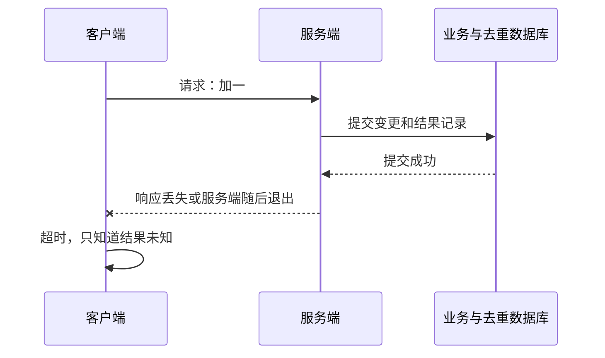
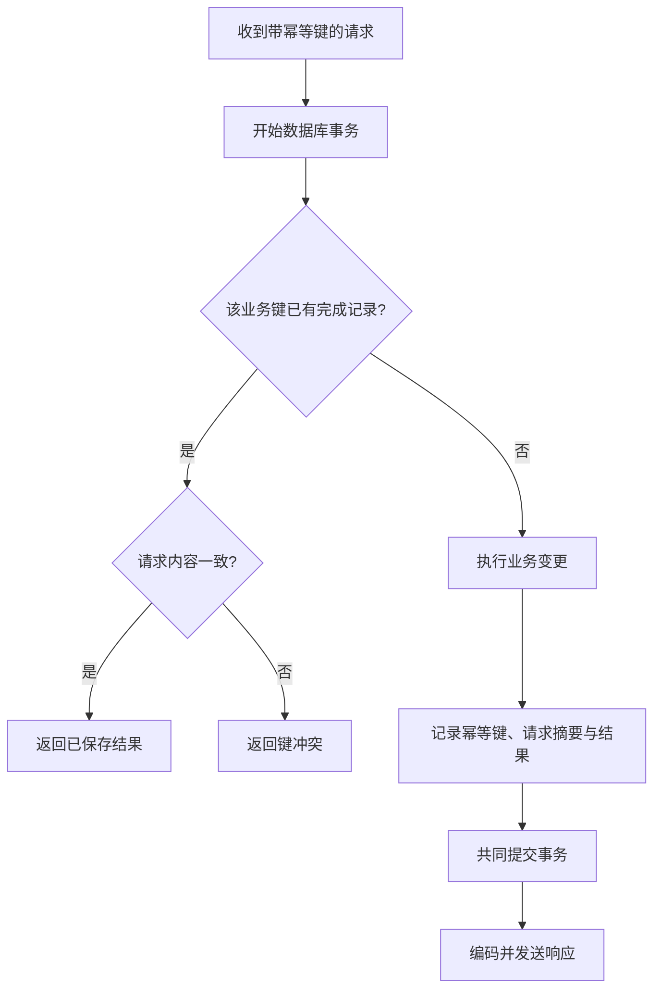
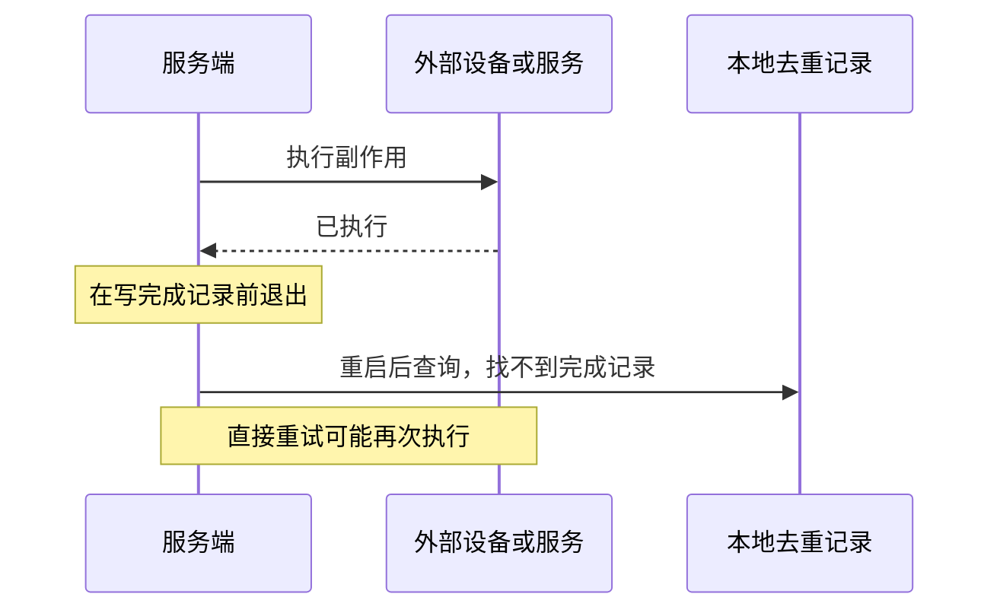
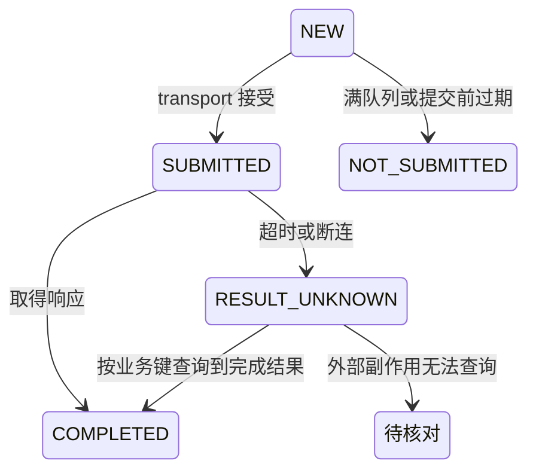

远程过程调用（RPC，Remote Procedure Call）换成同机共享内存之后，仍有队列满、超时、服务端退出和响应丢失。传输更快，并不能让失败时的业务结果变得确定。

本文用“给数据库中的计数器加一”解释请求状态与去重。示例的业务变更、去重记录和结果都在同一数据库事务中；外部硬件、第三方接口和另一个数据库不自动获得相同保证。

## 读完能带走什么

- 判断失败发生时是未提交，还是业务结果未知。
- 为一次调用编号与一次业务幂等键分别定义生命周期。
- 说明跨重启去重为什么需要持久状态和业务变更的一致提交。

## 1. 先把客户端状态与服务端状态分开

| 客户端观察 | 能确定什么 | 不能确定什么 |
|---|---|---|
| 明确返回队列满且未提交 | 本次没有进入队列 | 其他调用的结果 |
| 提交成功 | transport 接受消息 | 服务端是否开始执行 |
| 收到可核验结果 | 对应业务返回结果 | 后续调用是否仍成功 |
| 提交后超时或断连 | 等待未得到结果 | 是否已经执行或提交业务变更 |

服务端知道已提交，不等于客户端知道。不能把超时编码成“操作失败且未发生”，否则调用方很容易重复执行。

## 2. 三个标识的职责

| 标识 | 作用 | 重试或重启时的规则 |
|---|---|---|
| `session_generation` | 隔离 transport 会话和共享区域 | 重连后变化，拒绝旧代际响应 |
| `request_id` | 关联一次调用尝试与等待对象 | 新尝试可以分配新编号 |
| `idempotency_key` | 标识同一次业务意图 | 仍是同一业务意图时保持不变 |

不能把会话代际直接当去重键的一部分，导致一重启就失去同一业务意图的身份。客户端若需要跨自身重启重试，也要能恢复原键，而不是每次启动随机产生新键。

幂等键（idempotency key）应与授权范围、方法和规范化请求内容绑定。相同键但不同金额、目标对象或参数，应返回冲突，而不是返回旧结果冒充新请求成功。

## 3. 同一事务内完成业务变更和去重

一个简单的持久记录可包含 `(client_scope, method, key)` 唯一键、请求摘要、结果内容和完成时间。结果保存可重建的业务数据，不保存只在当前共享映射中有效的 offset 或指针。

图中的“检查不存在 → 变更 → 记录”必须由事务隔离、唯一约束和相应并发控制共同保证。不能用无锁的先查后写让两个 worker 同时认为不存在。冲突或事务重试时，不得把业务变更绕到事务外执行。

SQLite 可作为同机示例的存储实现，其事务原子提交机制参见 [SQLite Atomic Commit](https://www.sqlite.org/atomiccommit.html)。进程退出与断电持久性也要结合 journal/WAL、同步配置、文件系统和介质核验；“有事务”不是忽略部署持久化配置的理由。

### 用故障点审查承诺

| 服务端退出位置 | 同事务基线下应如何处理 |
|---|---|
| 事务提交前 | 未完成事务回滚，重试可重新处理 |
| 业务变更已提交但响应未发送 | 从持久去重记录读取结果，不再加一次 |
| 响应已经发送但客户端未观察到 | 客户端用原业务键查询或重试 |
| 只把去重结果写进内存 | 服务端重启后记录丢失，无法提供跨重启去重 |

本基线限制的是业务变更的重复提交，不是网络上只传一次请求，也不是每个客户端只收到一次响应。

## 4. 外部副作用留下什么窗口

如果业务是“向设备写寄存器”或“调用另一个服务”，本地数据库不能自动把外部动作和本地结果记录放入一个原子事务。

可以要求外部系统支持同一幂等键、提供可查询的操作编号，或按业务规则进行补偿和人工核对。事务发件箱（transactional outbox）能够把“业务变更与待发送事件”共同持久化，但重复投递仍需要接收端去重。

若提前提交一条 IN_PROGRESS 记录，再调用外部系统，重启后只能知道执行可能进行过；不能看见 IN_PROGRESS 就直接重跑或直接返回成功。必须定义查询与恢复策略。

## 5. deadline 与取消不是回滚

截止时间（deadline）限定调用者等待和系统资源预算。排队、发送、执行与重试都使用剩余预算，不能每次重试重新获得完整超时时长。

同机 transport 可约定经核验的共同单调时钟域；跨主机或不同时间域不能直接比较裸时钟数字，应传递并扣减剩余预算。gRPC 的 deadline 传播会考虑耗时与时钟差异，见 [gRPC Deadlines](https://grpc.io/docs/guides/deadlines/)。自定义共享内存协议需要自行定义对应规则。

取消可以阻止尚未开始的工作，也可让运行中的任务协作停止；已经提交的业务变更不会因此自动撤销。客户端取消 RPC 也不代表服务端已经结束所有衍生任务，见 [gRPC Cancellation](https://grpc.io/docs/guides/cancellation/)。

共享载荷的生命周期另算：客户端停止等待后，服务端可能仍在读载荷。不能仅因 deadline 到达就把载荷块放回池。参见 [[knowledge/通信与IPC/共享对象池与零拷贝：句柄、借用与回收]]。

## 6. 重试策略怎样收敛

| 情况 | 策略 |
|---|---|
| 明确未提交 | 剩余预算允许时可重新提交 |
| 纯查询，允许重新读取当前值 | 有界退避重试；不保证两次读取得到同一快照 |
| 有副作用且结果未知 | 使用原业务键与已定义的去重/查询协议 |
| 参数错误、版本不兼容、键内容冲突 | 修正请求，不盲目重试 |
| 服务持续不可用 | 退避、次数与总时限限制，避免积压 |

gRPC 的可配置重试还有提交点、可重试状态码和尝试次数等 transport 规则；收到 `UNAVAILABLE` 本身不能证明任意业务方法重试都安全。见 [gRPC Retry](https://grpc.io/docs/guides/retry/)。

## 7. 去重记录不能无限存，也不能随意删

定义业务允许的重试窗口、最长在途时间以及结果保留期。清理完成记录后，旧键再来可能被当作新操作；如果要避免这一点，应保留拒绝重放的标记或规定过期后只能核对、不能再次执行。

只设置 TTL 然后宣称永久 exactly-once，是不成立的。幂等保证必须写明方法、客户端身份、存储边界、保留窗口和重启条件。

## 8. 交付时要写清的接口合同

以 `INCREMENT_COUNTER` 为例：

- 入队失败返回 `NOT_SUBMITTED`，保证本次未提交。
- 入队后超时返回 `RESULT_UNKNOWN`，不能假定计数器没变。
- 重试携带同一个业务键，服务端同事务保存变更与结果。
- 键存在但内容不一致返回 `KEY_CONFLICT`。
- 跨重启读取持久结果，再用当前会话代际和新的 request_id 返回响应。
- 超出保留窗口按约定拒绝重放或转人工/业务核对，不隐式再加一次。

本文尚未提供该持久去重实现或真实重启记录。现有配套示例只实现序号交接的教学设计，尚无 Linux 运行记录，没有实现 RPC、数据库事务或幂等表；不能把示例的 complete 输出当作本篇语义已实现。

## 相关阅读

- [[knowledge/网络与DPDK/实践/RPC 技术与分层详解]]
- [[knowledge/通信与IPC/共享内存通信框架：协议、队列与故障恢复]]
- [[knowledge/通信与IPC/共享内存双进程实践：握手、背压与退出]]
